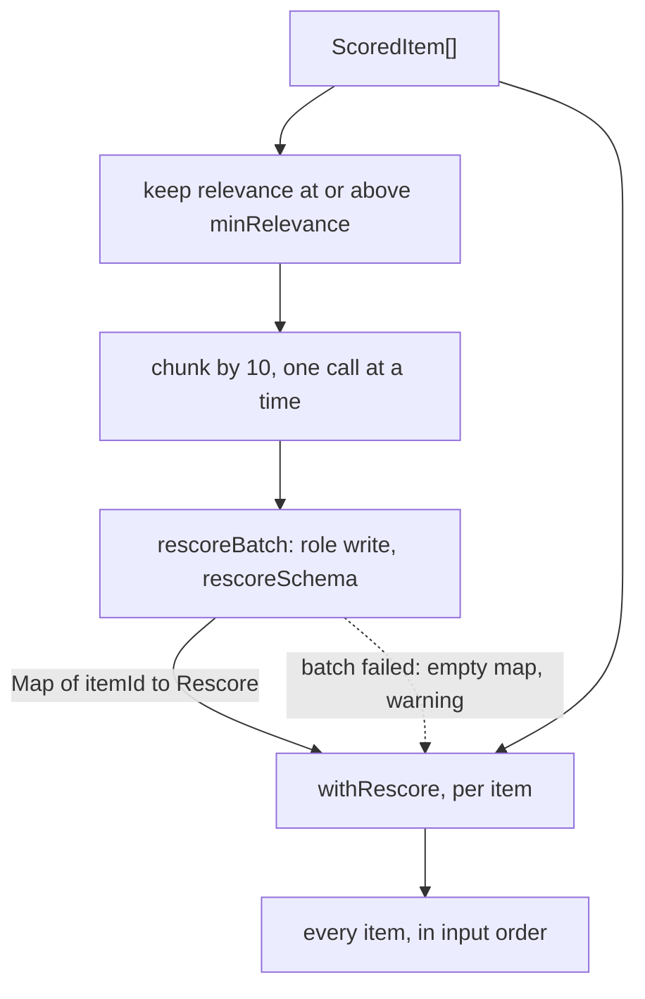

# Classify rescore

> An optional second reader: the writer model re-judges the items that passed the relevance floor.
> Entry: `rescoreFiltered(scored, minRelevance, deps: ClassifierDeps) → ScoredItem[]`
> (`rescoreFiltered.ts`). Port: `ModelProvider.generate`, role `write`, through `generateStructured`.

## Flow

## Rules

- The writer's relevance replaces the decider's. Its area replaces the decider's only when it
  answers confidence `high` (then area confidence is 1). Hype and minorRelease stay the decider's.
- A batch that fails (bad JSON after the repair, a model error) keeps the decider's scores for its
  items and warns. An `AbortError` is rethrown, so a stopped run stops.
- An item the writer leaves out keeps its score, with a warning. A repeated id keeps the first answer.
- Only the shortlist is sent. Relevance is an integer 0 to 3 and is never clamped: one entry outside
  the schema fails the whole reply after the repair, and the batch keeps the decider's scores.

## Files

| File                 | Role                                                                               |
| -------------------- | ---------------------------------------------------------------------------------- |
| `rescoreFiltered.ts` | `rescoreFiltered`: filter, batches, log counts; private `withRescore`              |
| `rescoreBatch.ts`    | `rescoreBatch` (one call, repair and failure handling), `rescoreSchema`, `Rescore` |

Tests build `ScoredItem`s with `makeScoredItem` and script the writer with `rescoreReply`.

## Gotchas

- The pass is off by default (`models.rescoreWithWriter`). `classify.ts` checks that `minRelevance`
  is set before any model call; `evals/rescoreReplay.ts` (`evals/rescore/`) measures the pass.
- Imports `chunk` and the limits from `../batching/`: keep that direction, `batching/` must not
  import this folder.
- The prompts are in `../classifyPrompt.ts` (`rescoreSystem`, `rescorePrompt`).
