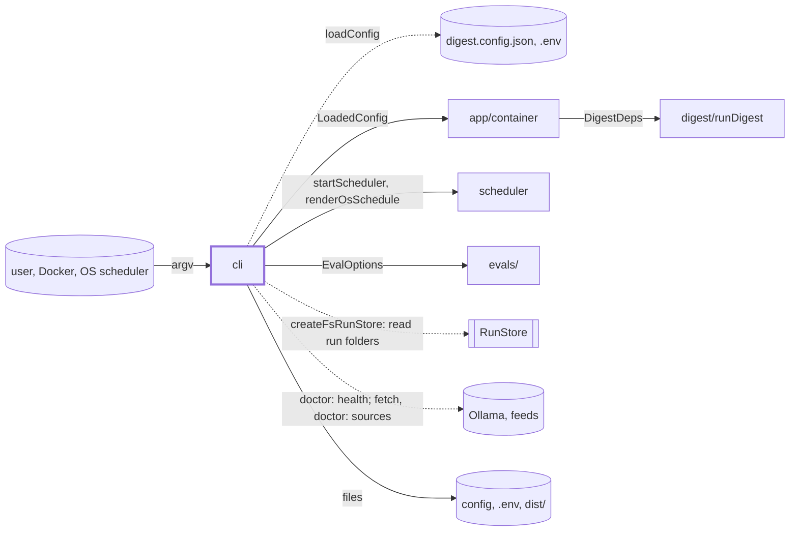
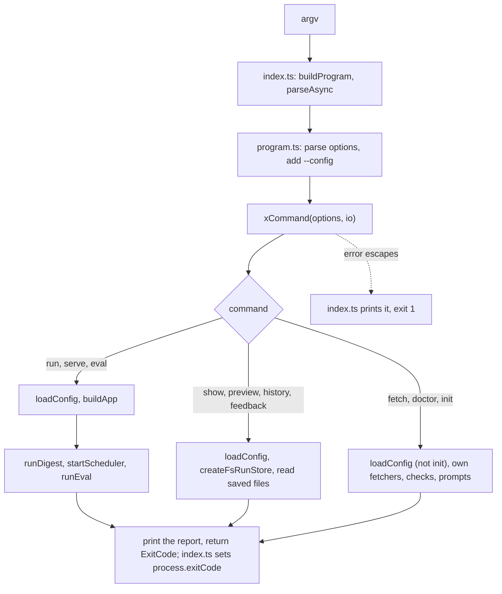

# CLI

> The `digest` command: one command line becomes one handler call, a short printed report and an
> exit code. Entry: `buildProgram(setExitCode)` (`program.ts`), driven by `index.ts`. Each handler
> is `xCommand(options, io?) → ExitCode`; tests replace `io` (config, app, files, output). No port.
> This file is the index: each command has a folder with its own `CLAUDE.md`. Reader page: `docs/features/cli.md`.

## Context

## Flow

## Rules

- A handler returns an `ExitCode`, never calls `process.exit`; commander exits 1 on a usage error.
- Exit codes are public: 0 sent or ok, 1 failed, 2 blocked, 3 quiet (`run` alone). A `DigestError`
  brings its own code, else 1; `init`, `eval`, `serve` rethrow other errors. `fetch` exits 1 on any
  failure, `doctor` on any `✗`, `eval` on a failed hard gate (not on a partial run).
- Output is cleaned. Secrets: `createRedactor(knownSecrets(secrets, env.OLLAMA_URL))` in `run`, `fetch`,
  `doctor`, `show` and `preview` (the set values, the webhook path, the `OLLAMA_URL` password);
  `doctor` also strips `user:pass@` and names `.env` keys, never values. Feed and model text:
  `show`, `preview`, `fetch`, `eval` strip control, bidi and tag characters; tables cut long cells.
- `show`, `preview`, `history`, `feedback`, `fetch` build no app, take no lock, call no model.
- Lint stops the pipeline from importing adapters, not `src/cli`. The CLI uses them for three
  reasons: the default dep behind a port (`createFsRunStore` as `RunStore` in `show`, `preview`,
  `history`, `feedback`); a pure helper that must match the pipeline (`run` prints where the markdown
  channel writes, `preview` renders with the channels' own renderers and `writeFileAtomic`); a tool
  that looks outside (`doctor`, `fetch`). Records, artifacts and run lists go through the port.

## Files

| File / folder | Role                                                                                                                                                             |
| ------------- | ---------------------------------------------------------------------------------------------------------------------------------------------------------------- |
| `index.ts`    | Entry, bundled by `scripts/build.mjs` to `dist/artifacts/cli.js`. Frozen                                                                                         |
| `program.ts`  | Registers the 10 commands and the global `-c, --config` and `-V, --version`. Frozen                                                                              |
| `init/`       | `initCommand`: prompts or `--yes`; writes config and `.env`; OS schedule or Docker. `prompts/ configFile/ envFile/ schedule/ summary/ io/`. See `init/CLAUDE.md` |
| `doctor/`     | `doctorCommand`: a line per check, `fix:` on `✗`/`!`. `report/ checks/ envFile/ folders/ readiness/`. See `doctor/CLAUDE.md`                                     |
| `run/`        | `runCommand`: `buildApp`, `runDigest`, summary; a dry run still writes the Markdown file. See `run/CLAUDE.md`                                                    |
| `eval/`       | `evalCommand`: `runEval` per profile, scorecard to `evals/scorecards/`. `scorecardText/ judgeSetup/ compare/`. See `eval/CLAUDE.md`                              |
| `fetch/`      | `fetchCommand`: sources only, no model, no lock. `plan/ sourceRun/ report/ saveRun/`. See `fetch/CLAUDE.md`                                                      |
| `show/`       | `showCommand <week>`: summary, or one part. `tables/ summary/`, `showError.ts`, `parseFile.ts`. See `show/CLAUDE.md`                                             |
| `preview/`    | `previewCommand <week>`: renders the winning draft per channel into files, sends nothing. See `preview/CLAUDE.md`                                                |
| `history/`    | `historyCommand`: last 12 runs; exports the duration helpers. See `history/CLAUDE.md`                                                                            |
| `feedback/`   | `feedbackCommand <week>`: `review.md` ticks to `<dataDir>/feedback/<week>.json`. See `feedback/CLAUDE.md`                                                        |
| `serve/`      | `serveCommand`: `startScheduler`; signal 1 stops and waits, 2 aborts the run, 3 exits. See `serve/CLAUDE.md`                                                     |

## Gotchas

- A new command or option needs the coordinator (`program.ts`, `index.ts` are frozen); a field added
  to a handler's options type does nothing until `program.ts` registers its flag. Tests pin printed
  text, table headers and `fix:` lines.
  `program.test.ts` replaces every handler and pins the options each flag delivers (`FLAG_CASES`), so
  a renamed flag or a new one without a row fails there.
- Some folders import a sibling: `run`, `show/summary` and `fetch/report` take the duration helpers
  from `history/history`; `run` takes `parseSince` from `fetch/plan/parseSince.ts`; `init` takes the RAM check and its measured wording from
  `doctor/readiness/memory.ts`; `eval.ts` imports `evals/`.
  `test/integration/harness/runCli.ts` calls `runCommand`.
- `fetch/fetch.tap.test.ts` lets only `fetch/sourceRun/{buildFetchers,recorder,types}.ts` among the
  CLI files say `tap` or `SourceTap`, and only `buildFetchers.ts` call `createFetcher(`. A new CLI
  file that does either fails it.
