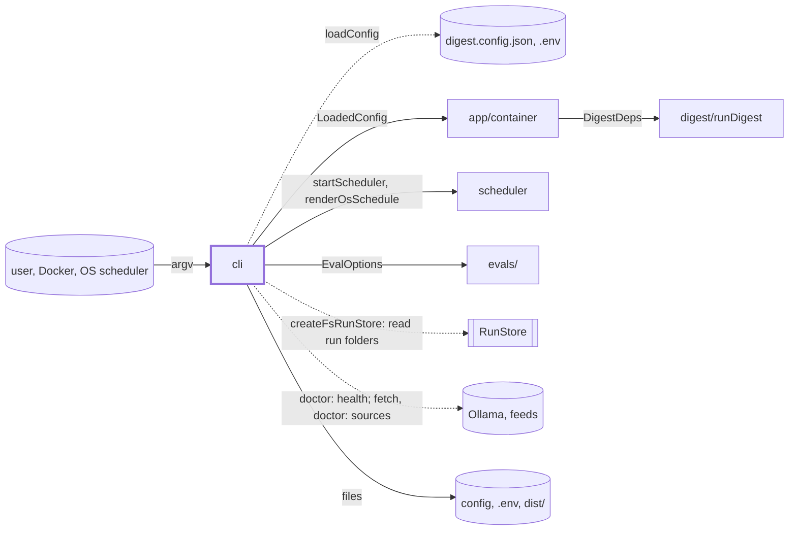
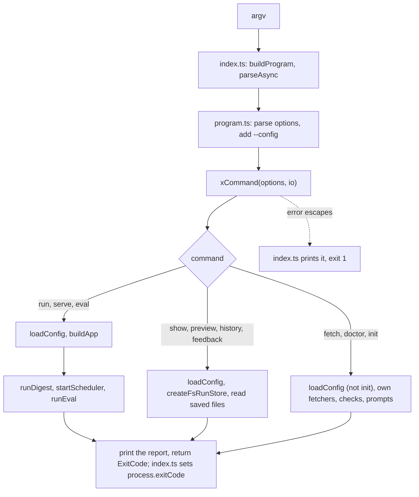

# CLI

> The `digest` command: one command line becomes one handler call, a short printed report and an
> exit code. Entry: `buildProgram(setExitCode)` (`program.ts`), driven by `index.ts`. Each handler
> is `xCommand(options, io?) → ExitCode`; tests replace `io` (config, app, files, output). No port.

## Context

## Flow

## Rules

- A handler returns an `ExitCode`, never calls `process.exit`; commander exits 1 on a usage error.
- Limits: `--since` 1d to 31d (`run`, `fetch`), `--seed` 0 or more, `--limit` 1 or more.
- Exit codes are public: 0 sent or ok, 1 failed, 2 blocked, 3 quiet (`run` alone). `run`, `show`,
  `preview`, `history`, `feedback` return a `DigestError`'s own code, else 1; `init`, `eval`, `serve`
  rethrow other errors. `fetch` exits 1 on any failure, `doctor` on any `✗` (`--readiness`: when no
  profile can run here), `eval` on a failed hard gate (not on a partial run).
- Output is cleaned. Secrets: `redactSecrets` (`run`, `fetch`), `createRedactor` (`show`, `preview`);
  `doctor` also strips `user:pass@` and names `.env` keys, never values. Feed and model text:
  `show`, `preview`, `fetch`, `eval` strip control, bidi and tag characters; tables cut long cells.
- `show`, `preview`, `history`, `feedback`, `fetch` build no app, take no lock, call no model.
  `fetch` writes only its sources' `<day>/<source>/` folders and `fetch-summary.json` below `--out`
  (default `dataDir`), never the digest folder or the lock; a second fetch that day replaces them.
- `init` refuses to overwrite `digest.config.json` under `--yes`. It merges `.env` (`OLLAMA_URL` only
  if absent), writes it mode 0600 via temp file and rename (in place on a Docker bind mount), and
  fails if it stays readable by others. It recommends `light` until `quality` has a measured baseline.

## Files

| File / folder | Role                                                                                                      |
| ------------- | --------------------------------------------------------------------------------------------------------- |
| `index.ts`    | Entry, bundled by `scripts/build.mjs` to `dist/artifacts/cli.js`. Frozen                                  |
| `program.ts`  | Registers the 10 commands and global `-c, --config`. Frozen                                               |
| `init/`       | `initCommand`: prompts or `--yes`; writes config and `.env`; OS schedule or Docker                        |
| `doctor/`     | `doctorCommand`: a line per check, `fix:` on `✗`/`!`; subfolders, see `doctor/CLAUDE.md`                  |
| `run/`        | `runCommand`: `buildApp`, `runDigest`, summary; a dry run still writes the Markdown file                  |
| `eval/`       | `evalCommand`: `runEval` per profile, scorecard to `evals/scorecards/`; `--only`, `--resume`, `--compare` |
| `fetch/`      | `fetchCommand`: sources only, 4 at once, 10 s each, no retry; `fetch-summary.json` last                   |
| `show/`       | `showCommand <week>`: summary, or `--part` items, scores, drafts, digest, run, review                     |
| `preview/`    | `previewCommand <week>`: `--channel` files in the week's `digest/preview/`, sends nothing                 |
| `history/`    | `historyCommand`: last 12 runs; exports `formatDuration`                                                  |
| `feedback/`   | `feedbackCommand <week>`: `review.md` ticks to `<dataDir>/feedback/<week>.json`                           |
| `serve/`      | `serveCommand`: `startScheduler`; signal 1 stops and waits, 2 aborts the run, 3 exits                     |

## Gotchas

- A new command or option needs the coordinator (`program.ts`, `index.ts` are frozen);
  `program.test.ts` lists every command in order. A field added to a handler's options type does
  nothing until `program.ts` registers its flag.
- Tests pin printed text, table headers and `fix:` lines. `init` takes its `quality` RAM check (32 GiB,
  5% slack) from `doctor/readiness/memory.ts` (through a compat bridge), `eval.ts` imports `evals/`, and `test/integration/harness.ts`
  calls `runCommand`.
- `fetch.tap.test.ts` allows `fetch.ts` to name the source tap and call `createFetcher(`. Its
  `buildFetchers` mirrors `createGithubReleasesFetcher` (token picks REST, else Atom): change both.
- Over the 300 line cap: `init` 773, `fetch` 426, `eval` 409, `show` 312.
