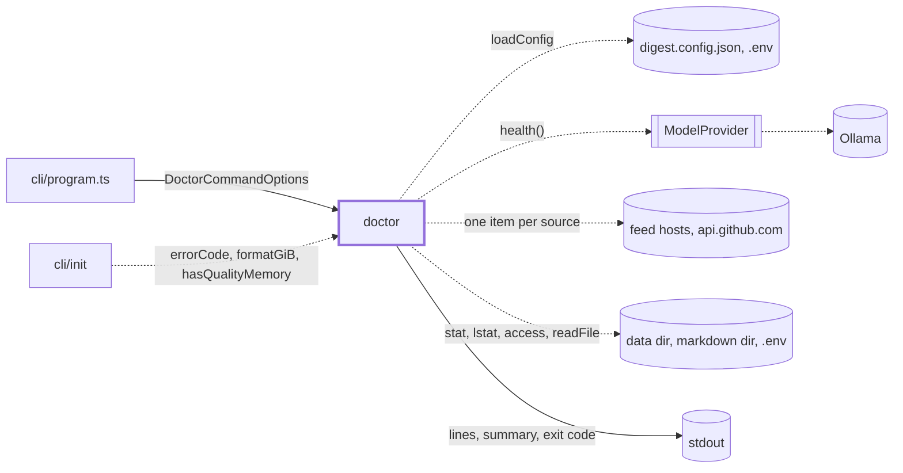
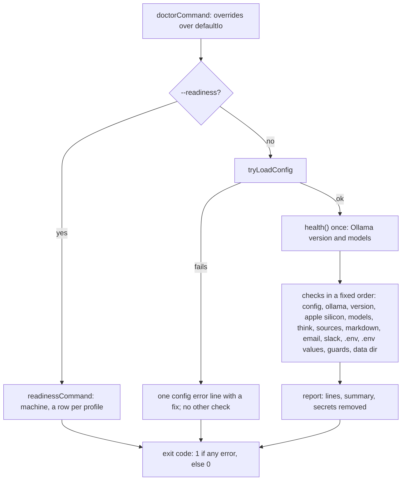

# Doctor

> `digest doctor`: tells the user in one screen whether this machine can run a digest and what to
> fix, with a `fix:` line under each problem. `--readiness` prints the machine and a verdict per
> profile instead. Entry: `doctorCommand(options, overrides?) → exit code` (`doctor.ts`). Tests
> replace `DoctorIo`. No port. Reader page: `docs/features/cli.md`.

## Context

## Flow

- Doctor sends nothing. It reads one item from each feed (last day, 10 s each) and asks Ollama for its
  version and models. A broken feed is a warning, because a run skips that feed.
- The platform judged is the one the loader resolved for the profile, so a bad `DIGEST_HOST_OS` is a
  config error and the checks judge the host the profile was chosen for.

## Rules

- All outside access goes through `DoctorIo` (`types.ts`): config loader, provider, `fetch`, clock,
  `stat`, `lstat`, `readFile`, `access`, stdout. Tests replace it with a fake machine.
- Output never carries a secret: `report` redacts the whole text, and the `.env` checks name a key
  and a line, never a value.
- An error is a missing model, an old Ollama, a blocked folder or a missing secret; a warning (a
  feed that fails, a loose `.env`, a guard switched off) never fails the exit code.
- A folder here never imports `doctor.ts`; shared types go in `types.ts`.

## Files

| File / folder  | Role                                                                                     |
| -------------- | ---------------------------------------------------------------------------------------- |
| `doctor.ts`    | `doctorCommand`, `DoctorCommandOptions`, `defaultIo`, `tryLoadConfig`                    |
| `types.ts`     | `DoctorIo`, `PathInfo`                                                                   |
| `errorCode.ts` | `errorCode`, `isNotFound`: read a Node error code                                        |
| `report/`      | Result type, lines, summary, exit codes, URL credential stripper. See `report/CLAUDE.md` |
| `checks/`      | Ollama, models, sources, delivery, guards. See `checks/CLAUDE.md`                        |
| `envFile/`     | `.env` permissions and values cut at `#`. See `envFile/CLAUDE.md`                        |
| `folders/`     | Can a run write to or create a folder. See `folders/CLAUDE.md`                           |
| `readiness/`   | `--readiness`: profile table, RAM, versions. See `readiness/CLAUDE.md`                   |

Tests sit next to the code. `__fixtures__/doctorHarness.ts` is the fake machine; `doctor.fs.test.ts`
and `doctor.defaults.test.ts` run the real disk calls and the real defaults.

## Gotchas

- Printed text, check labels, result order and exit codes are public: tests find lines by `label:`.
- `cli/init` imports `errorCode.ts` (`init/envFile/secretFile.ts`, `init/io/files.ts`) and
  `readiness/memory.ts` (`init/prompts/profile.ts`). Moving either breaks init.
- A new check is a function in `checks/` (its own folder if it is complex), one line in
  `doctorCommand` and a test on the harness.
