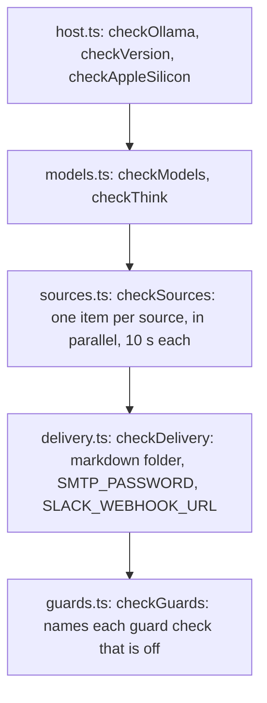

# Doctor checks

> One function per question doctor asks: is Ollama there, are the models pulled, do the feeds
> answer, are the delivery secrets set, which guards are off. Each returns `CheckResult`s and
> prints nothing. `doctor.ts` calls them in a fixed order.

## Flow

- `checkModels` checks every tag in `modelsInUse` (the `decision` capability on classify, guardPolicy and
  judge) and returns nothing when Ollama is unreachable. `checkAppleSilicon` judges the loader's host.

## Rules

- A check takes only what it needs (a `Pick` of the config, a slice of `DoctorIo`), so a test calls it
  with a few fields. A slow or broken feed is a warning, because a run skips that source.
- Nothing is sent. Delivery looks at whether a secret is set, never at its value.
- `checkThink` mirrors `effectiveThink` (`models/adapters/chat/chatSettings.ts`), so the two cannot
  drift.
- `INPUT_CHECKS` and `OUTPUT_CHECKS` repeat the guard checks in the order they run (`ruleInjection`
  first); `guards.test.ts` fails when `GuardCheckId` or the guard config gains one they do not list.

## Files

| File          | Role                                               |
| ------------- | -------------------------------------------------- |
| `host.ts`     | `checkOllama`, `checkVersion`, `checkAppleSilicon` |
| `models.ts`   | `checkModels`, `checkThink`, `describeThink`       |
| `sources.ts`  | `checkSources`, `checkSource`, `SOURCE_TIMEOUT_MS` |
| `delivery.ts` | `checkDelivery`                                    |
| `guards.ts`   | `checkGuards`, `INPUT_CHECKS`, `OUTPUT_CHECKS`     |

Tests are one per check, on the shared fake machine `../__fixtures__/doctorHarness.ts`.

## Gotchas

- `checkAppleSilicon` has a "not required" branch that no profile reaches today, since all three
  need Apple silicon. Keep it until a profile does not.
