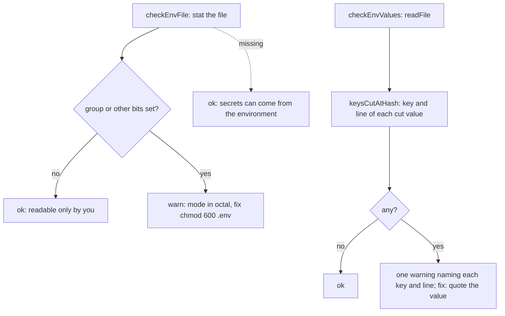

# Doctor .env checks

> Looks at the `.env` file without showing what is in it: warns when other users can read it, and
> when node's `.env` parser silently cut a value at a `#`. Entries: `checkEnvFile(io)` and
> `checkEnvValues(io)` (`envFile.ts`).

## Flow

## Rules

- Only the key and the line number leave the scan; the value is never copied into a result, a message
  or a log. A test checks that.
- `keysCutAtHash` copies the parser's rules (`node:util` `parseEnv`): an unquoted value ends at its
  first `#`; a quoted value ends at the next same quote, on a later line if need be; a quote that
  nothing closes stays plain text. So it never skips a line the parser reads.
- A missing file gives no `.env values` line: the `.env` line already says so. Any other read error
  is a warning with the reason.

## Files

| File               | Role                             |
| ------------------ | -------------------------------- |
| `envFile.ts`       | `checkEnvFile`, `checkEnvValues` |
| `keysCutAtHash.ts` | `keysCutAtHash`: the scan        |

`keysCutAtHash.test.ts` covers quotes, comments, `export`, CRLF, multi-line values and repeated keys.

## Gotchas

- If the loader's `.env` parser changes (`config/load.ts`), check `keysCutAtHash` against it.
- Never add the value to a message, even in part.
