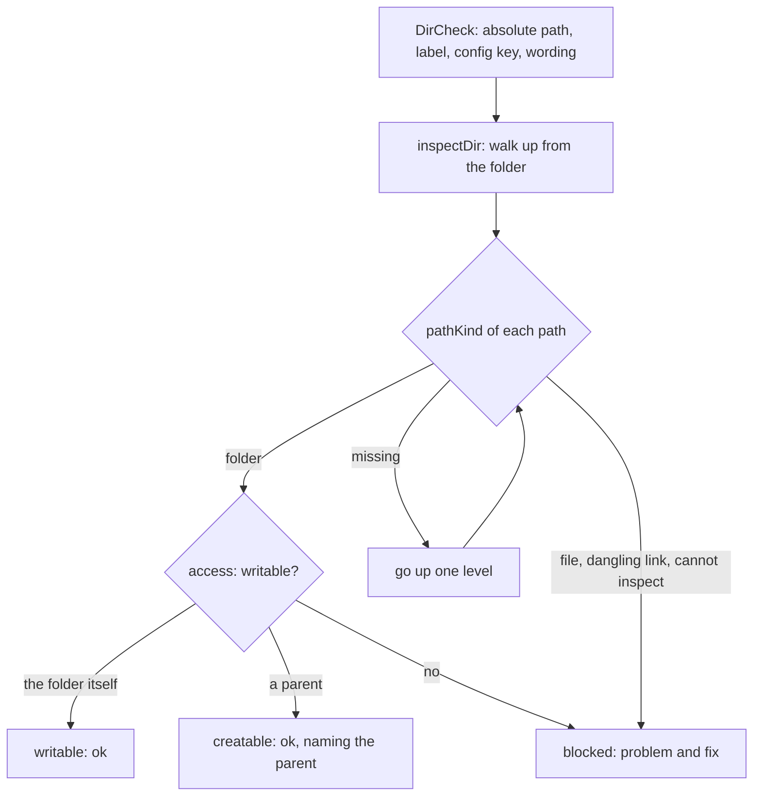

# Doctor folder checks

> Answers one question for each folder a run writes into (`dataDir`, and `delivery.markdown.dir` when
> set): can a run write here, or create it? Entry: `checkWritableDir(spec, io)` (`writableDir.ts`),
> built with `dataDirCheck(dir)` or `markdownDirCheck(dir)`.

## Flow

## Rules

- A missing folder is fine when its nearest existing parent is writable: the run creates it with
  `mkdir`. A file or a dangling symbolic link in the way, or a file further up, is an error.
- Links are followed with `stat` and told apart with `lstat`. `ENOENT` and `ENOTDIR` from `lstat`
  both mean missing (`isNotFound` of `shared/fsErrors`); climbing on finds the file that causes
  `ENOTDIR`. A link whose target cannot be `stat`ed is dangling on `ENOENT` only; any other error is thrown.
- A relative path is resolved against the working directory when the check is built. The fix names
  the config key, so the user knows what to change.
- All disk access goes through the `stat`, `lstat` and `access` of `DoctorIo`.

## Files

| File             | Role                                                               |
| ---------------- | ------------------------------------------------------------------ |
| `writableDir.ts` | `DirCheck`, `dataDirCheck`, `markdownDirCheck`, `checkWritableDir` |
| `inspectDir.ts`  | `inspectDir`, `pathKind`, `DirStatus`, `PathKind`, `DirIo`         |

`../doctor.fs.test.ts` runs the main cases on a real temporary folder.

## Gotchas

- `../checks/delivery.ts` calls `markdownDirCheck` only when `delivery.markdown.dir` is set; otherwise
  the data dir check covers the week folders.
