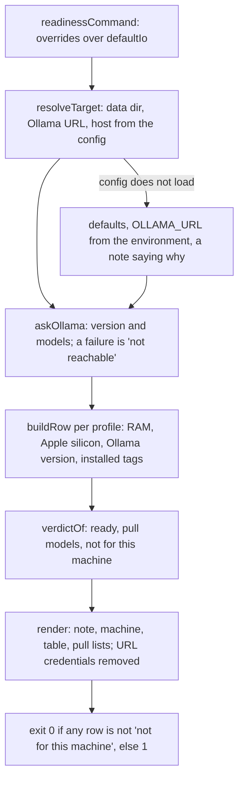

# Doctor readiness

> `digest doctor --readiness`: which profile can run on this machine, before the user has a config.
> Prints the machine, one row per profile (`quality`, `fast`, `light`) and the untuned `fallback`,
> and the `ollama pull` lines still missing. Entry: `readinessCommand(options, overrides?)`
> (`readiness.ts`). It contacts only Ollama.

## Flow

## Rules

- RAM: `quality` needs 32 GiB, `light` 16 GiB, less 5% (a "32 GB" Linux box reports about 31 GiB).
  The verdict stays `yes` at 32 GiB although `quality` swapped there (2026-10-19): only `digest init`
  warns, from `hasQualityHeadroom` (48 GiB, an estimate). Aligning this table is a follow-up.
  `fast` and `fallback` are not measured: they get the 16 GiB floor and print "yes (not measured)".
- A bad `DIGEST_HOST_OS` or `DIGEST_HOST_ARCH` is reported in the note, not thrown. The models folder
  is measured only for a local Ollama (`localhost`, `127.0.0.1`, `[::1]`).

## Files

| File           | Role                                                                                                     |
| -------------- | -------------------------------------------------------------------------------------------------------- |
| `readiness.ts` | `readinessCommand`, `ReadinessCommandOptions`, the default I/O                                           |
| `target.ts`    | `ReadinessIo`, `Target`, `resolveTarget`, `askOllama`, `localModelsDir`, `freeDiskBytes`, `ollamaHealth` |
| `rows.ts`      | `ProfileRow`, `buildRow`, `verdictOf`, `versionStatus`                                                   |
| `table.ts`     | `render`, `machineLines`, `tableLines`, `pullLines`                                                      |
| `memory.ts`    | `GIB`, `hasRam`, `hasQualityMemory`, `hasQualityHeadroom`, `fitsRam`, `formatGiB`, `RowName`             |
| `version.ts`   | `parseVersion`, `compareCore`, `normalizeTag`, `DEVELOPMENT_VERSION`                                     |

`readiness.test.ts` runs the whole command on fakes (RAM, disk, Ollama injected).

## Gotchas

- `memory.ts` is imported by `cli/init/prompts/profile.ts` (`hasQualityMemory`, `formatGiB`): init and
  the table share the RAM figures so they cannot drift. `version.ts` is shared with `../checks/`.
- The table text is pinned by tests. Do not reorder the columns.
