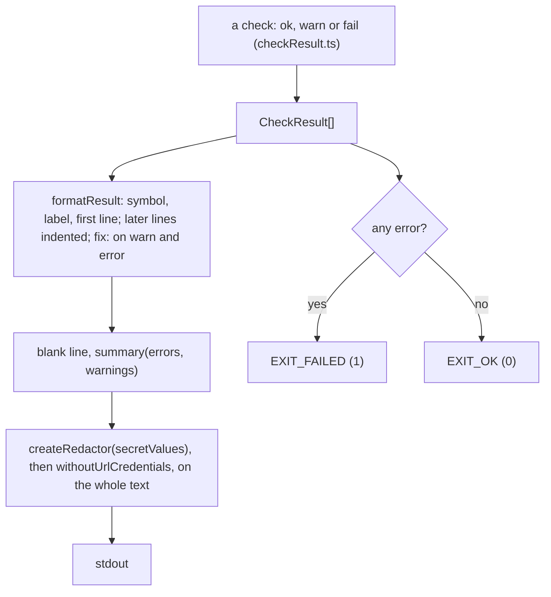

# Doctor report

> Everything doctor prints. A check returns a `CheckResult`; `report(results, stdout, secretValues)`
> (`report.ts`) turns the list into lines, a summary and the exit code. It also holds
> `withoutUrlCredentials`, which `--readiness` uses too.

## Flow

## Rules

- Redaction runs on the finished text, so no check has to remember it: a secret or a `user:pass@`
  in an Ollama or feed error cannot reach the terminal. `secretValues` is `knownSecrets(secrets,
env.OLLAMA_URL)`: the `OLLAMA_URL` password is hidden by value, as an error may echo it alone.
- `fix` shows only for warnings and errors; an ok result never prints one. Warnings never fail.
- Exit codes are public (`exitCodes.ts`): `EXIT_OK` 0, `EXIT_FAILED` 1, `EXIT_NONE_FIT` 1
  (readiness: no profile fits). Do not renumber.

## Files

| File                       | Role                                            |
| -------------------------- | ----------------------------------------------- |
| `checkResult.ts`           | `CheckResult`, `Severity`, `ok`, `warn`, `fail` |
| `report.ts`                | `report`, `formatResult`, `summary`             |
| `withoutUrlCredentials.ts` | Strips `user:pass@` from `http(s)` URLs         |
| `exitCodes.ts`             | `EXIT_OK`, `EXIT_FAILED`, `EXIT_NONE_FIT`       |

One test per file; `report.test.ts` also runs the redaction end to end.

## Gotchas

- Tests pin the symbols, the indent, `fix:` and the summary wording.
- Do not move redaction into the checks, and print no value from `.env`.
