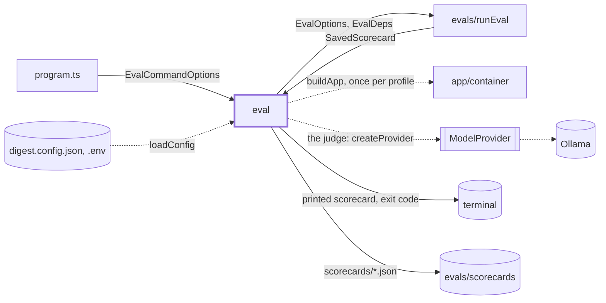
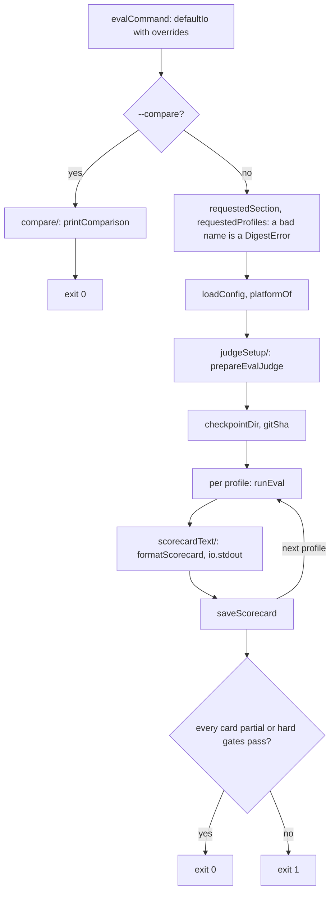

# Eval command

> `digest eval`: replays the eval set per profile, prints each scorecard, saves it and returns the
> exit code. Entry: `evalCommand(options, io?) → ExitCode` (`eval.ts`). No port: the harness is
> `evals/runEval.ts`, and every outside touch goes through `EvalCommandIo`.

## Context

## Flow

- A `DigestError` goes to stderr and returns its own exit code; any other error is rethrown.
- The scorecard file is `<casesDir>/scorecards/<day>-<profile>.json`, or
  `<day>-<profile>-partial-<section>.json` for `--only`, so a partial never replaces a full one.

## Rules

- Print first, then save: a failed save must not lose the result of a long run.
- Every profile builds the app from the loaded config with the platform the loader resolved
  (`platformOf`), not one recomputed from `process`: a container on a Mac must match its profile.
- Arguments are checked before `loadConfig` and before any model call; `--compare` needs no config.
- A hard gate that fails exits 1, but the other profiles of `--profile all` still run. A partial
  run reports its gates and never fails: the other sections were not run.
- One judge, built once, serves all profiles; its installed check runs before the first replay.
- The file is written through `SavedScorecardSchema.parse`: a card that does not match the schema
  throws instead of landing on disk.

## Files

| File / folder    | Role                                                                                                                                            |
| ---------------- | ----------------------------------------------------------------------------------------------------------------------------------------------- |
| `eval.ts`        | `evalCommand`, `EvalCommandOptions`, `EvalCommandIo`, `defaultIo`, `currentGitSha`, profile and section parsing, `runProfiles`, `saveScorecard` |
| `scorecardText/` | The printed scorecard and the table cells. See `scorecardText/CLAUDE.md`                                                                        |
| `compare/`       | `--compare`: read two cards and print the table. See `compare/CLAUDE.md`                                                                        |
| `judgeSetup/`    | The judge from the `EVAL_JUDGE` variable. See `judgeSetup/CLAUDE.md`                                                                            |
| `__fixtures__/`  | `scorecardKit.ts`: `makeScorecard`, a card whose metrics all pass                                                                               |

`eval.test.ts` covers profiles, saving, exit codes, platform and judge wiring; `eval.fast.test.ts`
`--only`, `--resume` and `--compare`; `eval.defaultIo.test.ts` the real disk, stdout, stderr and git.

## Gotchas

- This folder imports `evals/`: `runEval`, `metrics`, `schema`, `checkpoint`, `checkpointSections`,
  `compare` and `judge/evalJudge`. Renaming one of those exports breaks the command. Nothing in
  `evals/` imports `src/cli`.
- A new option reaches argv only when the frozen `program.ts` registers it (the coordinator);
  `program.test.ts` pins the flags.
- `currentGitSha` runs `git` in the working directory. A dirty tree adds a hash of the diff, so
  editing a prompt makes `--resume` start over; outside a checkout the value is new every time.
- `EVAL_JUDGE` is two things (the environment variable and a model-tag constant): see
  `judgeSetup/CLAUDE.md`.
