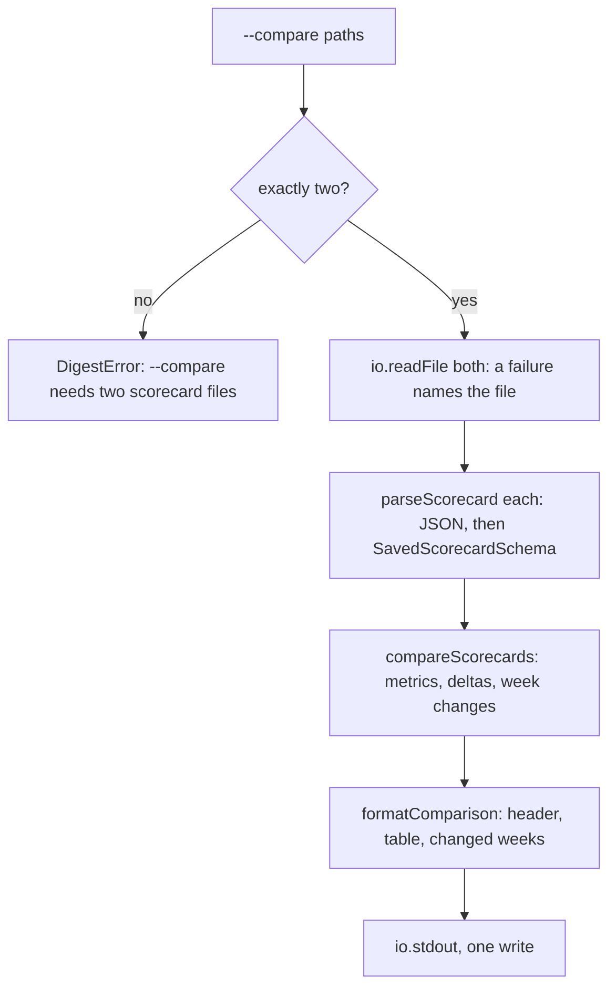

# Compare

> `digest eval --compare <a> <b>`: reads two saved scorecards and prints what changed. Nothing is
> run and no model is called. Entry: `printComparison(paths, io) → Promise<void>`
> (`printComparison.ts`). The data comes from `compareScorecards` in `evals/compare.ts`.

## Flow

## Rules

- Both files are read and parsed before anything is printed, so a bad second file leaves no half
  table behind.
- A file that cannot be read, is not JSON or is not a scorecard throws a `DigestError` that names
  the file; `evalCommand` prints it and returns its exit code. A successful comparison is exit 0:
  a failed gate in either card does not change that.
- A metric one side did not measure (a partial card) prints `n/a` and its weeks are not compared.
  The header says so when either card is partial.
- The gate column is B's (`Gate (B)`): B is the card the reader is judging. The result column
  shows both, as `FAIL -> PASS`, or one word when it did not change.

## Files

| File                  | Role                                                                        |
| --------------------- | --------------------------------------------------------------------------- |
| `printComparison.ts`  | `printComparison`, `CompareIo` (`readFile`, `stdout`): read, compare, print |
| `formatComparison.ts` | `formatComparison`: header, metric table, deltas, the weeks that changed    |

Both have a test beside them. `formatComparison.ts` takes its cells from
`../scorecardText/cells.ts`; `scorecardText/` never imports this folder.

## Gotchas

- Delta units follow the metric: `pt` for a ratio, `s` for milliseconds, else two decimals.
- `evals/compare.ts` owns the data and the "not a scorecard" error text; change them there.
