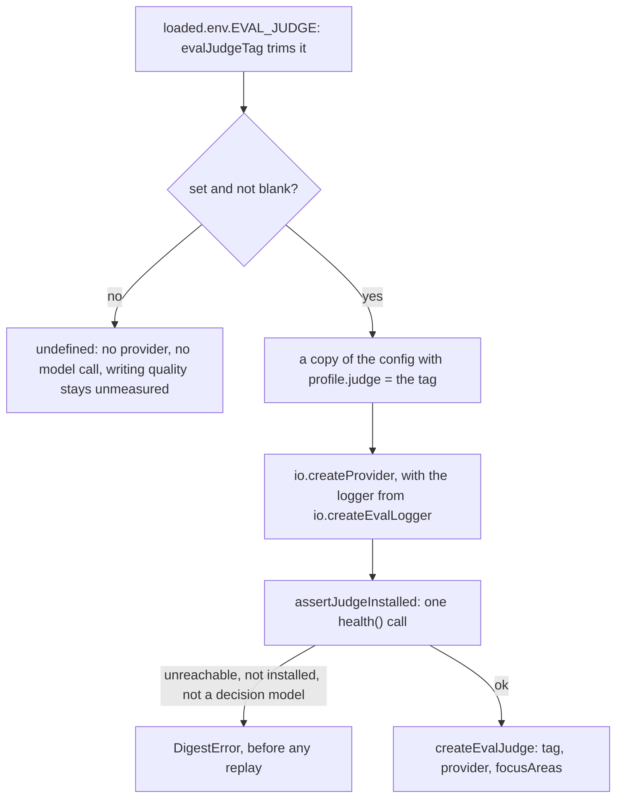

# Judge setup

> Builds the judge that scores the winning digests of a profile that has none of its own, from the
> `EVAL_JUDGE` environment variable. Entry: `prepareEvalJudge(loaded, io) → EvalJudge | undefined`
> (`prepareEvalJudge.ts`). Port: `ModelProvider`, made by `io.createProvider`.

## Flow

## Rules

- `EVAL_JUDGE` here is the environment variable (`EnvSchema.EVAL_JUDGE`, read from `loaded.env`:
  `.env` with the shell on top). The model-tag constant `EVAL_JUDGE` of `config/profiles.ts`
  (`MODEL_TAGS.clef`) is another thing: the fallback judge `resolveProfile` gives a profile when
  config lists 2 or more writers. This folder never imports it.
- Only `loaded.env` is read, never `process.env`: the loader already merged them, and a second
  source could disagree with it.
- The check runs before the first replay, so a typo costs no long run. It never pulls a model.
- `light` and `fast` have no judge, and the judge role resolves through the profile, so the provider
  gets a copy of the config with the tag in `profile.judge`. The caller's config is not changed.
- It takes `JudgeSetupIo` (two functions), not `EvalCommandIo`: it never imports `eval.ts`.

## Files

| File                       | Role                                                                                   |
| -------------------------- | -------------------------------------------------------------------------------------- |
| `prepareEvalJudge.ts`      | `prepareEvalJudge`, `JudgeSetupIo`: the steps in the flow above                        |
| `prepareEvalJudge.test.ts` | Blank values, `.env` and shell through the real `loadConfig`, the provider, the checks |

## Gotchas

- `eval.ts` builds the judge for every run that has `EVAL_JUDGE` set, even when each profile run has
  a judge of its own (`quality`): the harness then ignores it (`judgeWinners` runs only when
  `app.profile.judge === null`), but the installed check still applies.
- The error texts come from `evals/judge/evalJudge.ts` and name `EVAL_JUDGE`; tests match them.
