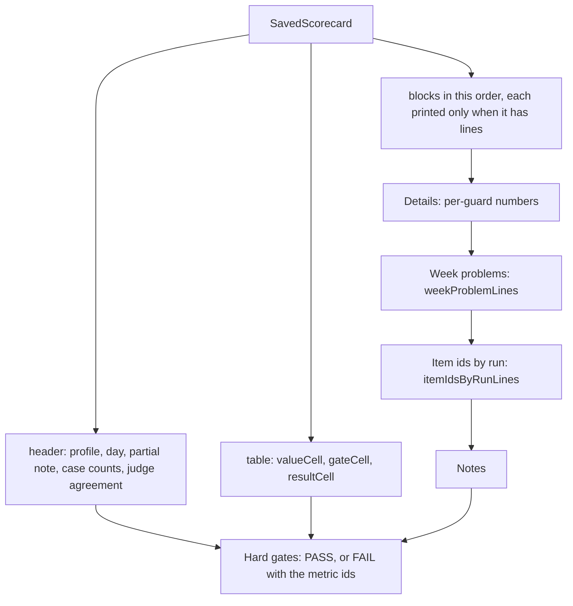

# Scorecard text

> The scorecard `digest eval` prints, as plain text, and the table cells `compare/` reuses.
> Entry: `formatScorecard(scorecard) → string` (`formatScorecard.ts`). Pure: no I/O, no model, no port.

## Flow

## Rules

- Text a model or a feed wrote goes through `safeText` or `oneLine` before it is printed: control
  and format characters (escapes, C1, zero-width, bidi, tag) and the line and paragraph separators
  become one space. A hostile feed must not move the cursor, recolor the terminal or reorder what is read.
- A link that matched no collected item prints as `unmatched`, never its URL: a model wrote it.
- Only the first 3 problems of a week are printed, then "... N more": the scorecard file keeps the
  rest, up to what it stored. A week with status `ok` is left out.
- `cells.ts` serves the compare table too: a change there changes both outputs.

## Files

| File                 | Role                                                                       |
| -------------------- | -------------------------------------------------------------------------- |
| `formatScorecard.ts` | `formatScorecard`: header, table, blocks, verdict; `detailText`, `section` |
| `cells.ts`           | `valueCell`, `gateCell`, `resultCell`, `table`: the aligned table          |
| `weekProblems.ts`    | `weekProblemLines`, `MAX_PROBLEMS_SHOWN`: failed and empty weeks           |
| `itemIds.ts`         | `itemIdsByRunLines`, `ITEM_IDS_TITLE`: short ids per run                   |
| `printable.ts`       | `safeText`, `oneLine`, `plural`, `MAX_PRINTED_PROBLEM_CHARS`               |

Each file has its test beside it; scorecards come from `../__fixtures__/scorecardKit.ts`.

## Gotchas

- `safeText` is `printableLine` (`src/shared/text.ts`, frozen on issue branches): it matches the
  Unicode classes `Cc` and `Cf` plus the whole tag block, not a list. A zero-width joiner splits a
  joined emoji into its parts.
- Tests pin the exact lines, spacing and the "(judge)" and "reported" gate words. A new metric
  needs no code here: it prints from `METRIC_IDS` and the `MetricResult` fields.
