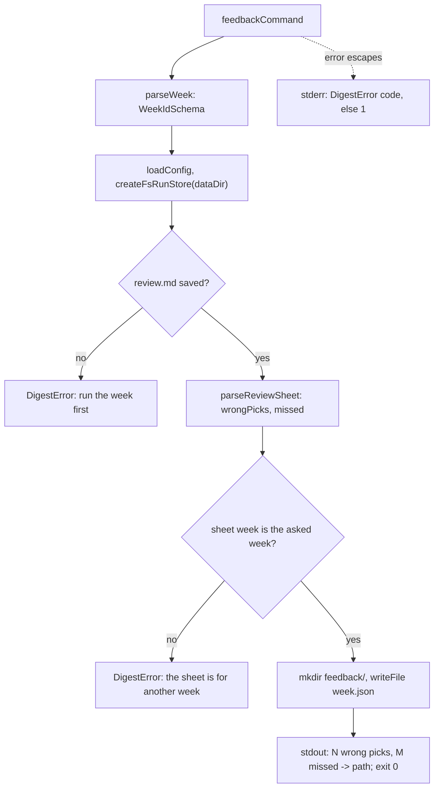

# Feedback command

> `digest feedback <week>`: turns the ticks in a week's `review.md` into
> `<dataDir>/feedback/<week>.json`, which `evals/feedbackToLabels.ts` merges into the eval labels.
> Entry: `feedbackCommand(options, deps?) → exit code` (`feedback.ts`). Builds no app, takes no lock,
> calls no model. Tests replace `FeedbackCommandDeps`. Reader page:
> `docs/runbooks/debug/missing-or-wrong-item.md`.

## Flow

- A tick `- [x]` under `## Picked` is a wrong pick; under `## Candidates` it is a missed item. The
  file holds `{ weekId, wrongPicks, missed }` as indented JSON with a final newline.

## Rules

- All checks run before the write. A bad week id, a missing sheet, an item line that was edited,
  one listed twice or outside the two sections, a missing section and a sheet of another week
  each fail with exit 1 and a message, and write nothing. `parseReviewSheet` names the line.
- The week id is checked against `WeekIdSchema` before the store is opened, so `../x` never reaches
  a path. The sheet's own week is checked against it too: a copied sheet cannot label the wrong week.
- A second run replaces `<week>.json`.

## Files

| File          | Role                                                                            |
| ------------- | ------------------------------------------------------------------------------- |
| `feedback.ts` | `feedbackCommand`, `FeedbackCommandOptions`, `FeedbackCommandDeps`, `parseWeek` |

`feedback.test.ts` builds a sheet with `buildReviewSheet` and ticks it; it uses `MemoryRunStore` and
a fake `writeFile`, plus one real-disk case.

## Gotchas

- The `feedback` folder name is a literal here (`FEEDBACK_DIR`) and in `evals/feedbackToLabels.ts`,
  not in `store/layout.ts`. Rename it in both, and in `docs/reference/files-and-paths.md`.
- The sheet format belongs to `render/reviewSheet.ts`: `buildReviewSheet` writes it, `parseReviewSheet`
  reads it. A change to the markup changes both.
- The file is written with a plain `writeFile` through `deps`, not `writeFileAtomic`: a crash can
  leave a half-written file, and the next run replaces it.
- The printed line is shown in `docs/runbooks/maintain/add-eval-case-from-a-bad-week.md`.
