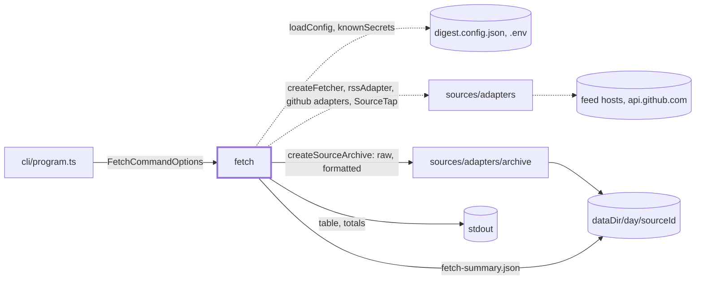
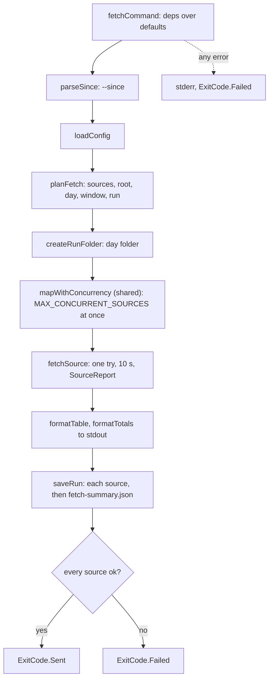

# Fetch

> `digest fetch`: fetches the configured sources with the fetchers a run uses and saves what each
> one answered and what it was read into, so a source can be looked at without a run, a model or a
> lock. Entry: `fetchCommand(options, deps?) → ExitCode` (`fetch.ts`). Tests replace
> `FetchCommandDeps` (config, `fetch`, clock, output). No port. Reader page: `docs/features/cli.md`.

## Context

## Flow

- The order is fixed on purpose: a bad `--since` or source id fails before any request, and the
  output folder is made before the first request, so an unwritable `--out` shows at once.
- A failed source never stops the others. Its raw body is still saved, to look at.

## Rules

- No run state: no lock, no digest folder, no model. It writes only `<out>/<day>/<source>/` and
  `<day>/fetch-summary.json`; a second fetch that day replaces them.
- Same fetchers as a run (same adapters, same pipeline), plus a recorder that a run does not have.
  One try per source with a 10 s limit, no retry: it shows what a source does the first time.
  Sources run `MAX_CONCURRENT_SOURCES` at once (`sources/collect.ts`), as in a run's collect step.
- The summary comes last, so a day folder with a summary is complete.
- Texts the command wrote (table, errors, summary) are cleaned of every secret, the `OLLAMA_URL`
  password included (`knownSecrets`). Collected data
  (bodies, items) is cleaned only of the GitHub token, the one secret sent: another secret that is
  a common word must not change what a feed said.
- Exit code: 0 when every source worked, else 1 (also for any thrown error, printed to stderr).

## Files

| File / folder | Role                                                                             |
| ------------- | -------------------------------------------------------------------------------- |
| `fetch.ts`    | `fetchCommand`, `FetchCommandOptions`, `FetchCommandDeps`, the default deps      |
| `plan/`       | `--since`, `--source`, the output root and day, the window. See `plan/CLAUDE.md` |
| `sourceRun/`  | The recorder, the fetchers, one source. See `sourceRun/CLAUDE.md`                |
| `report/`     | The table, the totals line, the summary object. See `report/CLAUDE.md`           |
| `saveRun/`    | The day folder and the files written. See `saveRun/CLAUDE.md`                    |

Tests sit next to the code. `__fixtures__/fetchHarness.ts` is the scripted network and temp data
folder; `makeReport.ts` builds `SourceReport`s. `fetch*.test.ts` run the whole command.

## Gotchas

- `fetch.tap.test.ts` lets only `sourceRun/buildFetchers.ts`, `recorder.ts` and `types.ts` use the
  words `tap`, `SourceTap`, `SourceAnswer`, `SourceEntries`, and only `buildFetchers.ts` call
  `createFetcher(`. Keep those words out of the other files, comments included.
- `buildFetchers` mirrors `createGithubReleasesFetcher` (a token picks REST, else Atom): change both.
- File names and `raw/` extensions come from `sources/adapters/archive/sourceArchive.ts`, not here.
  The paths in the summary are what its `save` returns.
- `UNPRINTABLE` (in `sourceRun/fetchSource.ts`) and `plural` (in `report/totals.ts`) are local
  copies; other commands keep their own.
- Tests pin the printed table headers, the totals line and every error text.
