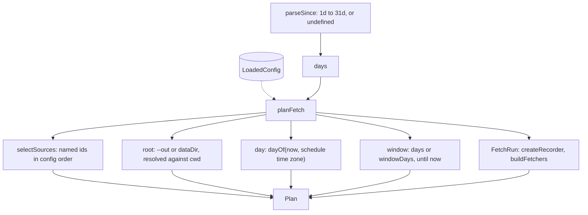

# Fetch plan

> Decides everything before the first request: which sources, where to write, which day, which
> window, and the fetchers with their recorder. Entry: `planFetch(...) → Plan` (`planFetch.ts`),
> after `parseSince(since) → days`. No port.

## Flow

## Rules

- Bad input fails here, before any network use: an unknown source id or a `--since` outside
  1d to 31d throws a `DigestError`.
- `parseSince` runs before the config loads, so a typo in `--since` never reads the config.
- A blank `--out` counts as absent. A relative `--out` and `dataDir` resolve against `env.cwd`,
  not the process directory.
- The clock is read once: `startedAt`, the day and the window all come from that reading. `Plan` and
  the option types live in `types.ts` so no file here imports `fetch.ts`.

## Files

| File               | Role                                                          |
| ------------------ | ------------------------------------------------------------- |
| `planFetch.ts`     | `planFetch`: sources, root, day, window, `FetchRun`           |
| `parseSince.ts`    | `parseSince`: `7d` to 7, with the 1 to 31 limits              |
| `selectSources.ts` | `selectSources`: the named ids, deduplicated, in config order |
| `types.ts`         | `Plan`, `PlanOptions`, `PlanEnv`                              |

## Gotchas

- `FetchCommandOptions` and `FetchCommandDeps` stay in `fetch.ts`: they satisfy `PlanOptions` and
  `PlanEnv` by shape. Add an option there and in `PlanOptions` only if planning reads it.
- The day folder uses the schedule's time zone, so late evening UTC can be the next day.
