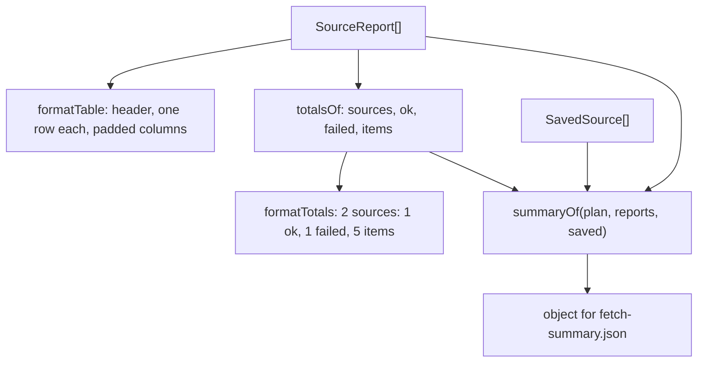

# Fetch report

> Turns the `SourceReport`s into what the command prints and saves: the table, the totals line and
> the object behind `fetch-summary.json`. Entry: `formatTable`, `formatTotals` (`totals.ts`),
> `summaryOf`. Pure functions; no port.

## Flow

## Rules

- A value a source never had is a dash in the table and `null` in the summary, so the JSON keeps
  every key. A failed source has no HTTP status, entry count or skipped count.
- The table cuts an error at 80 characters; the summary keeps what `fetchSource` kept (300).
- `saved[i]` belongs to `reports[i]`: the summary pairs them by position.
- Nothing here redacts: the caller cleans the printed text and the JSON before they leave.
- The table and totals text are pinned by tests: scripts may read them.

## Files

| File             | Role                                                                     |
| ---------------- | ------------------------------------------------------------------------ |
| `formatTable.ts` | `formatTable`: columns Source, Status, HTTP, Items, Skipped, Time, Error |
| `totals.ts`      | `totalsOf`, `formatTotals`, `Totals`; private `plural`                   |
| `summaryOf.ts`   | `summaryOf`, `SummaryPlan`: the summary object                           |

Tests sit next to each file and build reports with `../__fixtures__/makeReport.ts`.

## Gotchas

- `formatDuration` comes from `cli/history/history.ts`; the time column follows it.
- `plural` is a local copy; other commands keep their own.
