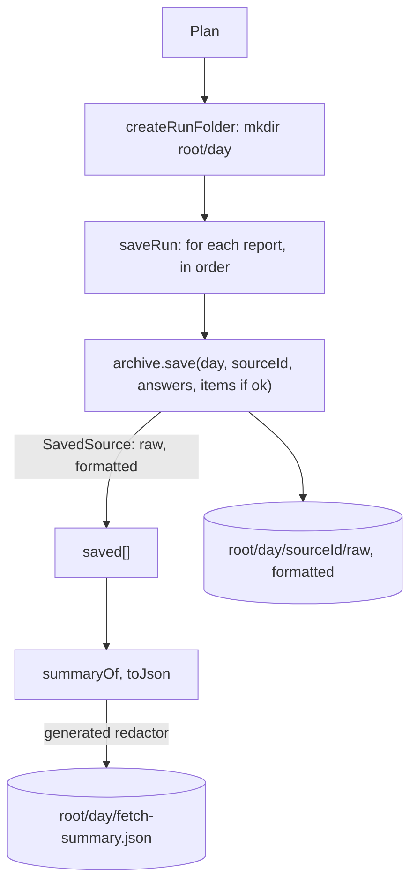

# Fetch save run

> Makes the day folder and writes what the fetch found: each source's answers and items through
> the source archive, then `fetch-summary.json`. Entry: `createRunFolder(plan)` (`runFolder.ts`),
> `saveRun(plan, reports, redact)` (`saveRun.ts`). No port; the archive is an adapter.

## Flow

## Rules

- The summary is written last, so a day folder that has it is complete.
- Two redactors, on purpose. `generated` (every secret) cleans the summary. `collected` (the GitHub
  token only) cleans bodies and items: another secret that is a common word must not change what
  a feed said.
- A failed source saves its answers but no `items.json`: `items` is passed only when `report.ok`.
- The archive replaces a source's `raw/` and `formatted/` of that day; other folders stay.
- The folder is made before the first request (`createRunFolder`), not here: an `--out` that
  cannot be written must fail before any network use. `saveRun` assumes it exists.

## Files

| File           | Role                                              |
| -------------- | ------------------------------------------------- |
| `saveRun.ts`   | `saveRun`, `SavePlan`, `SUMMARY_FILE`             |
| `runFolder.ts` | `runFolderOf` (`<root>/<day>`), `createRunFolder` |

Tests write to a temp folder; `saveRun.test.ts` records answers by hand with a recorder.

## Gotchas

- Paths in the summary come from `archive.save` (relative to the day folder, `/` on every system);
  the raw file names and extensions are decided in `sources/adapters/archive/sourceArchive.ts`.
- `store/layout.ts` owns the `dist/` layout; `runFolderOf` must agree with its `<root>/<day>`.
