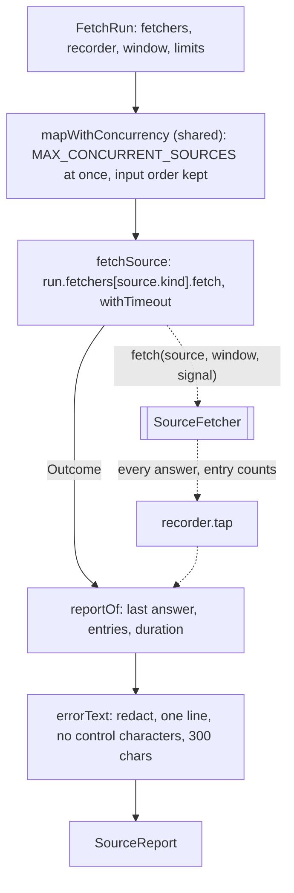

# Fetch source run

> Fetches the sources: the fetchers of a run wired to a recorder, one source at a time with a time
> limit. Entry: `fetchSource(source, run) → SourceReport` (`fetchSource.ts`); `fetch.ts` runs it
> through `mapWithConcurrency` (`shared/concurrency.ts`). Port: `SourceFetcher`.

## Flow

## Rules

- One try, no retry: this command shows what a source does the first time. The limit is the
  deps' `sourceTimeoutMs`, for the feed and any article pages together.
- A failure becomes a report with `ok: false` and no items, never a throw: the other sources and the
  saved raw body still count. Secrets leave an error text first, then it is cut.
- The recorder keeps answers per source id, so sources fetched at once never share answers.
- `answeredBy` is the last answer's URL as origin and path only (`withoutQuery` of the archive):
  a source URL may carry a secret in its query, and the summary is a file.
- `buildFetchers` picks REST with a GitHub token, else the Atom feed, as the container does.

## Files

| File               | Role                                                                    |
| ------------------ | ----------------------------------------------------------------------- |
| `fetchSource.ts`   | `fetchSource`, `errorText`; private `reportOf` and the `Outcome` type   |
| `buildFetchers.ts` | `buildFetchers`: the RSS and GitHub fetchers wired to the recorder      |
| `recorder.ts`      | `createRecorder`: answers and entry counts by source id, kept in memory |
| `types.ts`         | `SourceReport`, `FetchRun`                                              |

## Gotchas

- `buildFetchers.test.ts` uses the scripted network of `../__fixtures__/fetchHarness.ts`;
  `fetchSource.test.ts` uses `FakeSourceFetcher`.
- `recorder.ts`, `buildFetchers.ts` and `types.ts` are the only files here that may use the words
  `tap`, `SourceTap`, `SourceAnswer`, `SourceEntries` (`../fetch.tap.test.ts`), comments included.
- `Recorder.tap` has both listeners set (`Required<SourceTap>`), so tests call them directly.
