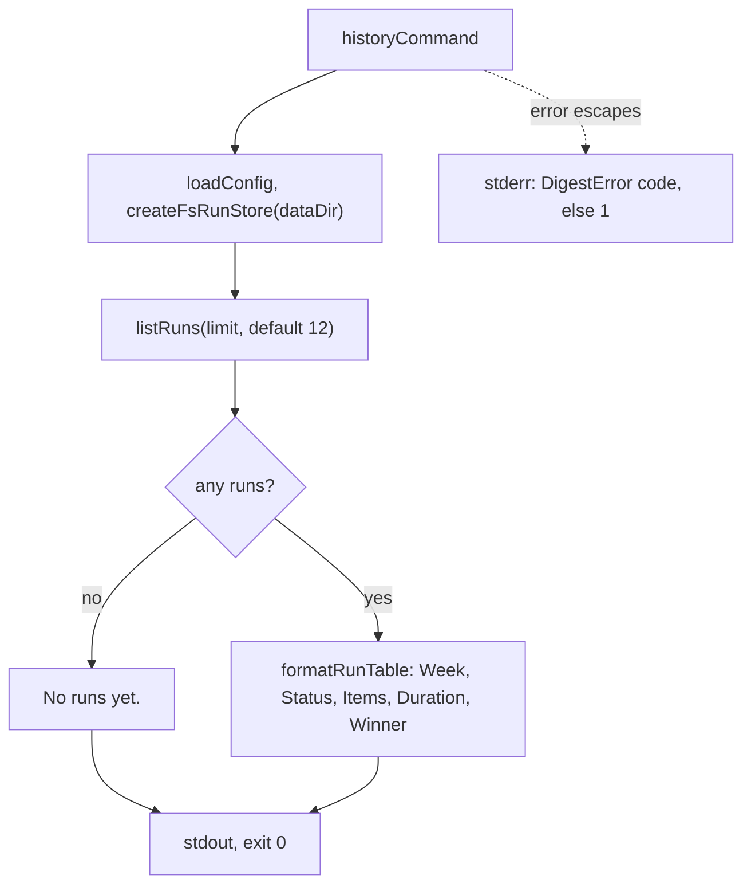

# History command

> `digest history`: lists the last runs, one line each, newest first. Entry:
> `historyCommand(options, deps?) → exit code` (`history.ts`). It also exports the duration helpers
> that `run`, `show` and `fetch` print with. Reads through the `RunStore` port; builds no app and
> takes no lock. Tests replace `HistoryCommandDeps`. Reader page:
> `docs/runbooks/observe/view-run-history.md`.

## Flow

- `Items` is `collected → digestItems`; `Winner` is `-` when no draft won. Columns are padded to the
  widest cell, two spaces apart, and trailing spaces are cut.

- A week whose record has a `variant` shows `sent*` in `Status`; the line `* a variant digest was
sent` follows the table only when some row has the mark. Without one the output is unchanged.

## Rules

- Read only: no app, no lock, no model. It redacts nothing, because `redactStore` cleaned every
  record when it was saved.
- The store gives the order (most recent first) and the cut-off; the command does not sort.
- `formatDuration(ms)` prints `7.5s` under a minute (tenths rounded down), `7m 12s` under an hour and
  `2h 15m` above. A negative span counts as zero. `formatRunDuration(record)` is `finishedAt` minus
  `startedAt`, both ISO strings the record schema has already checked.

## Files

| File         | Role                                                                                            |
| ------------ | ----------------------------------------------------------------------------------------------- |
| `history.ts` | `historyCommand`, `HistoryCommandDeps`, `formatRunTable`, `formatRunDuration`, `formatDuration` |

`history.test.ts` uses `MemoryRunStore`: wiring, the empty state, the table, errors, `formatDuration`
and a real-disk case.

## Gotchas

- `formatRunDuration` and `formatDuration` have three sibling-command importers: `run/run.ts` (the
  `Duration` line), `show/summary/summary.ts` (`Started:` and `Timings:`) and
  `fetch/report/formatTable.ts` (the duration column). A change to their text changes all four
  commands' output; `history.test.ts` pins the formats, the other tests pin their own lines.
- `-n, --limit` is checked by `program.ts` (a positive integer); the command takes `limit` as given.
- A new column needs the table header, `formatRunTable` and the runbook above to change together.
