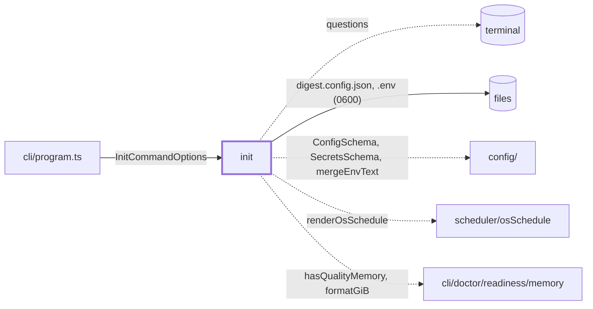
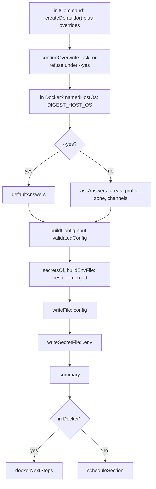

# Init

> `digest init`: asks a few questions (or takes the defaults with `--yes`), writes
> `digest.config.json` and a private `.env`, then says how to run the digest weekly. Entry:
> `initCommand(options, overrides?) → ExitCode` (`init.ts`). Tests replace `InitIo` (prompts, disk,
> machine, output). No port. Reader page: `docs/features/cli.md`.

## Context

## Flow

- A `DigestError` is printed to stderr and its exit code returned. Ctrl+C prints "Cancelled. Nothing
  was written." and returns 1. Any other error is rethrown.
- `recommendProfile()` lives in `init.ts` and is passed down: no subfeature imports the entry.

## Rules

- Every check runs before the first write (overwrite, answers, config schema, secrets, `.env`
  merge). Only the two writes can still fail: config first, then `.env`.
- The config is replaced only after a yes, and `--yes` refuses: nobody is there to confirm. `.env`
  is merged, never replaced, since it holds other settings. An empty file counts as absent:
  `make docker-init` creates empty files so the bind mounts exist.
- Secrets (SMTP password, Slack webhook) go to `.env` only, never to the config or the output.
- `.env` is mode 0600, written through a temp file and a rename, or in place where a rename cannot
  work (bind mount, read-only folder). A file that stays readable by others is not written.
- The default profile is `light` whatever the RAM: `quality` has no measured baseline yet. The
  schema default stays `quality`.
- `OLLAMA_URL` follows where init runs: `localhost`, `host.docker.internal` (Docker on a Mac, where
  only the host's Ollama has the GPU) or `ollama` (the compose service). One set by hand is kept.
- No schedule snippet in Docker, since the compose service schedules the run.

## Files

| File / folder | Role                                                                           |
| ------------- | ------------------------------------------------------------------------------ |
| `init.ts`     | `initCommand`, `runInit`, `recommendProfile`, `resolveOllamaUrl`               |
| `types.ts`    | `InitCommandOptions`, `InitIo`, `InitPrompts`, `Answers`, `Host`, `Validate`   |
| `paths.ts`    | `DEFAULT_CONFIG_PATH`, `DEFAULT_ENV_PATH`, `DOCKERENV_PATH`                    |
| `prompts/`    | The questions and `Answers`. See `prompts/CLAUDE.md`                           |
| `configFile/` | `ConfigInput` from the answers, validated, as JSON. See `configFile/CLAUDE.md` |
| `envFile/`    | `.env` text, merge, owner-only write. See `envFile/CLAUDE.md`                  |
| `schedule/`   | The OS schedule text. See `schedule/CLAUDE.md`                                 |
| `summary/`    | What was written, the Docker next steps. See `summary/CLAUDE.md`               |
| `io/`         | Real prompts, files, overwrite check. See `io/CLAUDE.md`                       |

Tests sit next to the code. `__fixtures__/initHarness.ts` is the scripted user and in-memory machine;
`init.realFs.test.ts` runs `initCommand` on a real folder.

## Gotchas

- Tests pin printed text and match prompts by their message (`/SMTP host/`, `/Model profile/`):
  rewording a question or a summary line breaks them on purpose.
- Two imports reach into `cli/doctor`: the RAM figures (`readiness/memory.ts`) and `errorCode.ts`.
  Moving either breaks init.
