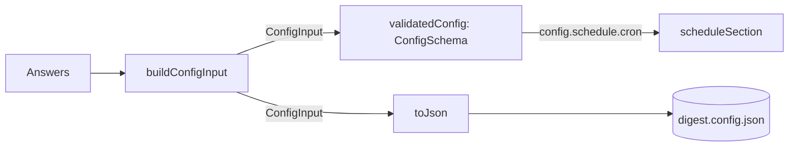

# Init config file

> Turns the `Answers` into the text of `digest.config.json`. Entry (`configFile.ts`):
> `buildConfigInput(answers)`, `validatedConfig(input)` and `toJson(input)`.

## Flow

## Rules

- Secrets are not in the config: the email password and the Slack webhook are `.env` only. Slack
  carries `enabled: true` and nothing else.
- Answers that do not make a valid config throw a `DigestError` that lists the fields, before any
  file is written. The prompts check as you type, so this is the net for a buggy prompt.
- `sources` is a new array each call, so adding or removing a source cannot change the defaults.

## Files

| File                | Role                                                        |
| ------------------- | ----------------------------------------------------------- |
| `configFile.ts`     | `buildConfigInput`, `validatedConfig`, `toJson`             |
| `describeIssues.ts` | `describeIssues`: one `path: message` line per schema issue |
| `*.test.ts`         | One per file; no fixtures                                   |

## Gotchas

- `toJson` writes the input, not the parsed config. Schema defaults (cron, thresholds, window) stay
  out of the file, so a later change of a default reaches users who ran `init` earlier.
- `prompts/focusAreas.ts` also uses `describeIssues`; this folder never imports `prompts/`.
