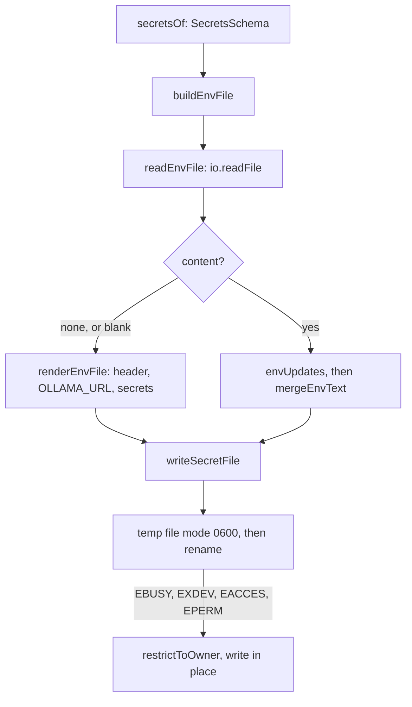

# Init .env file

> Builds the text of `.env` and writes it so only its owner can read it. Entry:
> `buildEnvFile(io, ollamaUrl, secrets) → { text, merged }` and `secretsOf(answers)`
> (`envText.ts`); `writeSecretFile(path, content)` (`secretFile.ts`).

## Flow

## Rules

- A secret the schema refuses is named by key, never printed.
- The merge touches only the keys it sets: other lines, comments, order and line endings stay.
  `OLLAMA_URL` is set only when absent or empty, a secret only when given.
- A value the merge cannot change safely (a line inside a multi-line value) stops init with
  nothing written; a value that cannot be quoted in `.env` does the same.
- The file is never readable by others: the temp file is created `0600`; in place, `chmod` comes
  first. A refused `chmod` is fine only if the file is already owner-only, else nothing is written.
- Only the bind-mount errors fall back to in place. Anything else (`ENOSPC`) is rethrown, the old
  file stays and the temp file is removed.

## Files

| File            | Role                                                                           |
| --------------- | ------------------------------------------------------------------------------ |
| `envText.ts`    | `secretsOf`, `renderEnvFile`, `buildEnvFile`, `readEnvFile`, `envUpdates`      |
| `secretFile.ts` | `writeSecretFile`: temp file and rename, or in place                           |
| `*.test.ts`     | `secretFile` runs on real files in a temp folder, with `rename`/`chmod` mocked |

## Gotchas

- The read-only-folder tests skip when run as root.
- `errorCode` comes from `cli/doctor/errorCode.ts`; `mergeEnvText` and `formatEnvValue` from
  `config/load.ts`. Never put a value in an error message.
