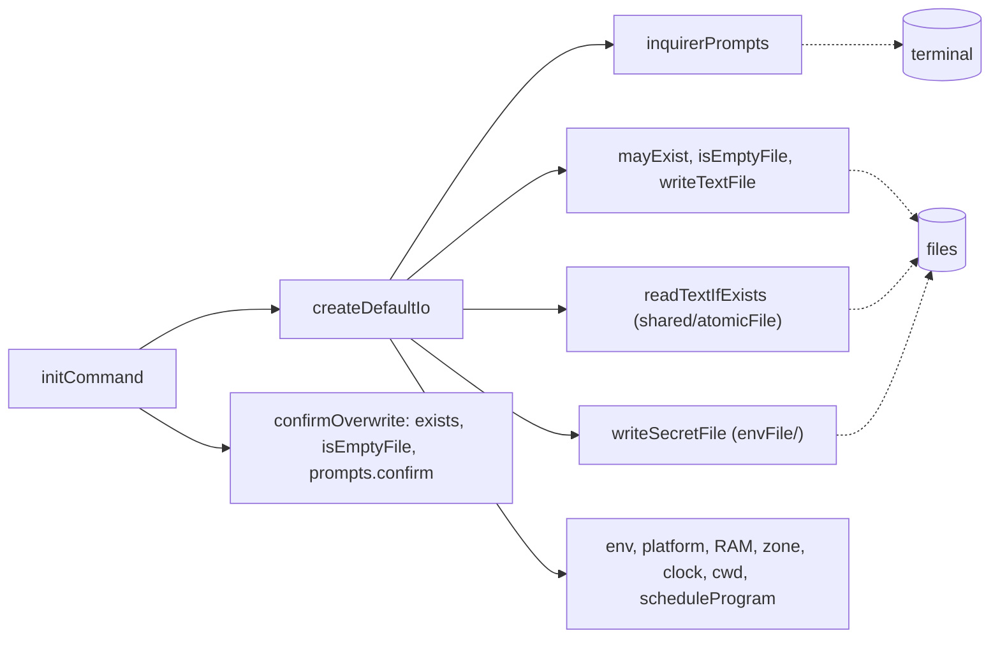

# Init io

> What `digest init` touches outside itself: the terminal, the disk, the machine. Entry:
> `createDefaultIo() → InitIo` (`defaultIo.ts`); `initCommand` merges `overrides` over it, so a
> test replaces any part.

## Flow

## Rules

- `mayExist` is `shared/fsErrors` `pathExists` with one decision on top: false only for a path known to
  be missing (ENOENT, or ENOTDIR below a file); a path it cannot check (EACCES, EIO, a link that
  loops) counts as "there", so init asks before it overwrites instead of failing or overwriting.
- `isEmptyFile` is false for anything it cannot stat, with the same reason: unknown means "has
  content". An empty file is treated as absent (see `confirmOverwrite`).
- `confirmOverwrite` asks with a default of no and refuses under `--yes`.
- `isPromptCancelled` spots the Ctrl+C error of inquirer; `initCommand` prints "Cancelled. Nothing
  was written." and returns 1.
- The default `readFile` is `readTextIfExists` (`shared/atomicFile`): `undefined` for a missing file, a
  rejection for anything else.

## Files

| File                  | Role                                                           |
| --------------------- | -------------------------------------------------------------- |
| `defaultIo.ts`        | `createDefaultIo`                                              |
| `inquirerPrompts.ts`  | `inquirerPrompts`, `isPromptCancelled`                         |
| `files.ts`            | `mayExist`, `writeTextFile`, `isEmptyFile`                     |
| `confirmOverwrite.ts` | `confirmOverwrite`                                             |
| `*.test.ts`           | `files` on a temp folder; `@inquirer/prompts` mocked elsewhere |

## Gotchas

- `defaultIo.test.ts` runs `initCommand` with the real prompt wiring and `@inquirer/prompts`
  mocked: it is the test that no question is lost on the way.
- This folder imports `envFile/secretFile` and `schedule/schedule` to fill the defaults.
