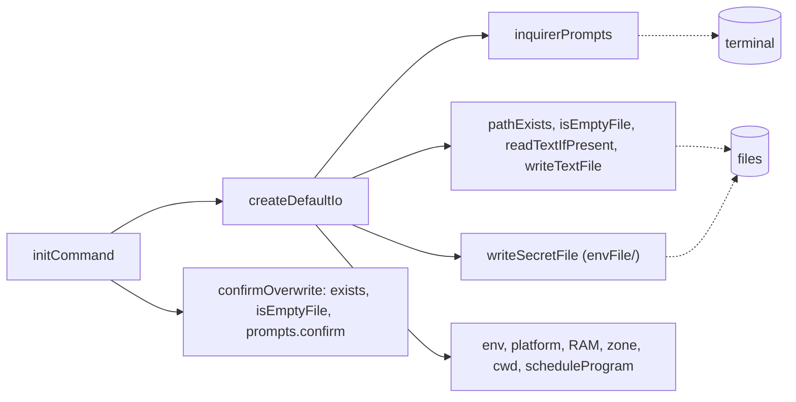

# Init io

> What `digest init` touches outside itself: the terminal, the disk, the machine. Entry:
> `createDefaultIo() → InitIo` (`defaultIo.ts`); `initCommand` merges `overrides` over it, so a
> test replaces any part.

## Flow

## Rules

- `pathExists` is false only for a missing path (ENOENT) or one below a file (ENOTDIR). Any other
  failure counts as "there", so init asks before it overwrites.
- `isEmptyFile` is false for anything it cannot stat, with the same reason: unknown means "has
  content". An empty file is treated as absent (see `confirmOverwrite`).
- `confirmOverwrite` asks with a default of no and refuses under `--yes`.
- `isPromptCancelled` spots the Ctrl+C error of inquirer; `initCommand` prints "Cancelled. Nothing
  was written." and returns 1.
- `readTextIfPresent` returns `undefined` for a missing file and rejects for anything else.

## Files

| File                  | Role                                                              |
| --------------------- | ----------------------------------------------------------------- |
| `defaultIo.ts`        | `createDefaultIo`                                                 |
| `inquirerPrompts.ts`  | `inquirerPrompts`, `isPromptCancelled`                            |
| `files.ts`            | `pathExists`, `readTextIfPresent`, `writeTextFile`, `isEmptyFile` |
| `confirmOverwrite.ts` | `confirmOverwrite`                                                |
| `*.test.ts`           | `files` on a temp folder; `@inquirer/prompts` mocked elsewhere    |

## Gotchas

- `defaultIo.test.ts` runs `initCommand` with the real prompt wiring and `@inquirer/prompts`
  mocked: it is the test that no question is lost on the way.
- This folder imports `envFile/secretFile` and `schedule/schedule` to fill the defaults.
