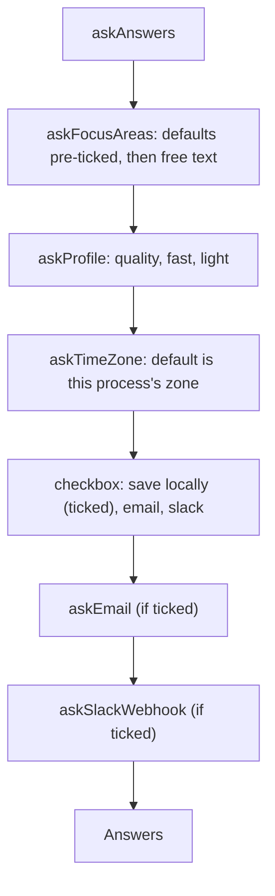

# Init prompts

> The questions of `digest init` and the `Answers` they give. Entry: `askAnswers(io, host, recommended)`
> and `defaultAnswers(io, recommended)`, both returning `Answers` (`answers.ts`). Prompts reach the
> terminal only through `io.prompts` (`InitPrompts`).

## Flow

## Rules

- A free-text answer is checked as typed (`validate`) and trimmed again when used.
- The SMTP password and Slack webhook are `password` prompts and come back apart from the delivery
  fields: they go to `.env`, never to the config.
- `quality` carries a RAM warning when this process sees under 48 GB (5% slack): under 32 GB it says
  quality needs 32 GB; from 32 GB up it says that is tight and quotes the measured swap and time
  (`QUALITY_TIGHT_RAM`). In Docker the container limit counts. `light` carries a warning unless the machine that runs Ollama is a Mac:
  in Docker the named `host.hostOs` beats the container's platform.
- "Save locally" is the first choice of the channels question, ticked, labelled with this week's
  folder (`localFolder`). Its `validate` refuses a selection without it, since the Markdown and HTML
  files are always written. Email and Slack start unticked. The week is counted in the schedule's
  zone, from `io.clock`; a zone `Intl` rejects counts in UTC, and the config check reports it later.
  In Docker the label reads `./dist/... on the host`: compose mounts `./dist` at `/app/dist`.
- Focus areas are unique ignoring case (first spelling wins), 1 to 25: `focusAreasProblem` asks the
  config schema, so the prompt and the file agree.

## Files

| File             | Role                                                          |
| ---------------- | ------------------------------------------------------------- |
| `answers.ts`     | `askAnswers`, `defaultAnswers`                                |
| `focusAreas.ts`  | `askFocusAreas`, `mergeFocusAreas`, `focusAreasProblem`       |
| `profile.ts`     | `askProfile`, `qualityMemoryWarning`, `PROFILE_DESCRIPTIONS`  |
| `timeZone.ts`    | `askTimeZone`, `isTimeZone`, `isContainerDefaultZone`         |
| `delivery.ts`    | `askEmail`, `askSlackWebhook`                                 |
| `saveLocally.ts` | `localFolder`, `saveLocallyChoice`, `requireSaveLocally`      |
| `validate.ts`    | `validateWith`, `isEmail`, `splitList`                        |
| `*.test.ts`      | One per file, driven by `scriptedPrompts` (`../__fixtures__`) |

## Gotchas

- Tests answer by matching the question text (`/SMTP host/`, `/Model profile/`): reword a prompt,
  fix the rules. A scripted checkbox answer runs the question's `validate`, so a channels answer
  must include `'markdown'`.
- `summary/` reuses `QUALITY_UNMEASURED` and `isContainerDefaultZone`. RAM figures: `doctor/readiness/memory.ts`.
