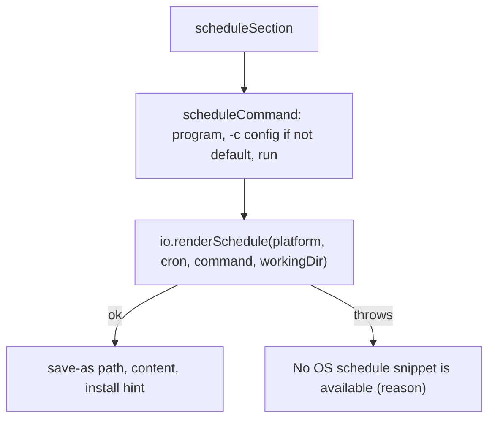

# Init schedule

> The text that tells the user how to run the digest every week. It wraps `renderOsSchedule`
> (`scheduler/`). Entry: `scheduleSection(io, configPath, cron)` (`schedule.ts`).

## Flow

## Rules

- A renderer failure never fails init: the reason is printed with the two ways to schedule by hand
  (`digest run` from a scheduler, or `digest serve`), and the exit code stays 0. The files are
  already written by then.
- The scheduled command works from any folder: `defaultScheduleProgram` is this node binary plus
  the absolute script. A TypeScript entry (a dev run through tsx) cannot be started by plain node,
  so it falls back to the installed `digest`.
- A config other than `./digest.config.json` is passed as `-c <absolute path>`; paths with
  whitespace are quoted.

## Files

| File          | Role                                                                            |
| ------------- | ------------------------------------------------------------------------------- |
| `schedule.ts` | `scheduleSection`, `scheduleCommand`, `defaultScheduleProgram`, `quoteIfSpaced` |
| `*.test.ts`   | Fake renderer; `process.argv` is replaced and restored                          |

## Gotchas

- Not called in Docker: `init.ts` prints the Docker next steps instead (`summary/`).
- `createDefaultIo` (`io/`) fills `scheduleProgram` and `renderSchedule` from here and `scheduler/`.
