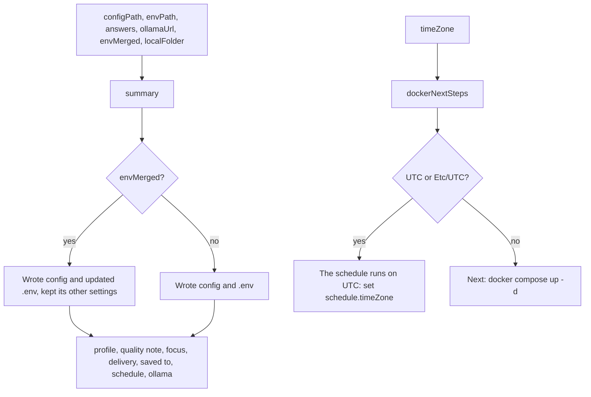

# Init summary

> What `digest init` prints after it wrote the files. Entry: `summary(info) → string` and
> `dockerNextSteps(timeZone) → string` (`summary.ts`).

## Flow

## Rules

- No secret in the output: the delivery line lists channel names only, never the password or the
  webhook. A test checks it.
- `saved to:` prints `localFolder` as the caller built it (`prompts/saveLocally`), also with `--yes`,
  so it is the folder the channels question showed (unless the run crossed a Monday). The summary does
  no path or clock work.
- `quality` gets a note that it is unmeasured and how to switch to `light`; the other profiles get
  none.
- In Docker the schedule is the compose service's, so the notes talk about the time zone: a
  container on UTC runs the Monday 07:45 digest at 07:45 UTC.

## Files

| File         | Role                                                    |
| ------------ | ------------------------------------------------------- |
| `summary.ts` | `summary`, `dockerNextSteps`                            |
| `*.test.ts`  | Exact text for the plain, merged, quality and UTC cases |

## Gotchas

- Tests pin the text, line by line.
- `QUALITY_UNMEASURED` (`prompts/profile.ts`) and `isContainerDefaultZone` (`prompts/timeZone.ts`)
  are shared with the prompts, so the question and the summary say the same thing.
