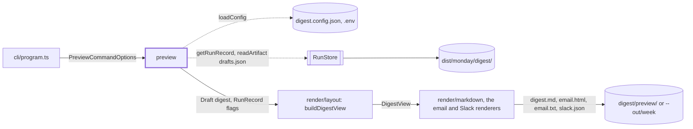
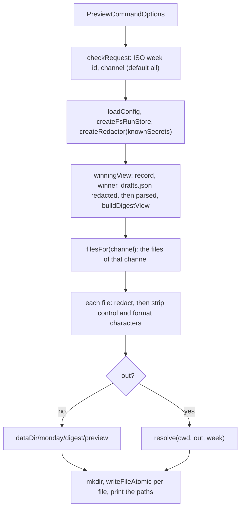

# Preview command

> `digest preview <week>`: renders a saved run's winning draft for each channel into files and
> sends nothing. Entry: `previewCommand(options, deps?) → exit code` (`preview.ts`). Builds no app,
> takes no lock, calls no model; it reads through the `RunStore` port. Tests replace
> `PreviewCommandDeps` (config, store, `cwd`, output). Reader page:
> `docs/runbooks/run/preview-a-week.md`.

## Context

## Flow

- Channels: `markdown` writes `digest.md`, `email` writes `email.html` and `email.txt`, `slack` writes
  `slack.json`, `all` (the default) writes all four.
- The view is built the way the run builds it, from the record's `disabledGuards` and `fallback`, so a
  fallback week and a guards-off week show their footers.
- A `PreviewError` is a `DigestError` (exit 1); its message is printed as it is.

## Rules

- Nothing is sent and nothing but the preview folder is written. Every check (week id, channel,
  record, winner, `drafts.json` present, valid JSON and shape, winner among the drafts) runs before
  the first write, so a failed request leaves no folder behind.
- A run with no winner (`winner` is null, for example a blocked or quiet week) has nothing to
  preview; the message names the week and its status.
- Secrets leave twice: `drafts.json` is redacted before it is parsed, and each file again before it
  is written. Feed text is untrusted, so control characters (not newline, tab or CR) and format
  characters (bidi overrides, tags, zero-width) are removed from every file.
- Each file is written with `writeFileAtomic`: a reader sees the old file or the new, never half.
  `--out` is resolved against `deps.cwd`, and the files go to `<out>/<week>/`.

## Files

| File         | Role                                                                                       |
| ------------ | ------------------------------------------------------------------------------------------ |
| `preview.ts` | `previewCommand`, `PreviewCommandOptions`, `PreviewCommandDeps`, `winningView`, `filesFor` |

`preview.test.ts` seeds a `MemoryRunStore` and writes to a temp `cwd`; it covers every channel, the
winner, the footers, `--out`, secrets, hostile text, each failure and the default wiring.

## Gotchas

- The CLI may call adapter code here because the preview must show what the channels send:
  `renderEmailHtml`, `renderEmailText` and `toSlackBlocks` are the very functions the email and Slack
  channels use, and `writeFileAtomic` (`shared/atomicFile`) is the writer the store and the channels
  use. A copy would drift. The `RunStore` port has no write for preview files (its artifact names
  are fixed). See `../CLAUDE.md`.
- `UNPRINTABLE` repeats the pattern of `clean` in `show/tables/table.ts`; `fetch`
  (`fetch/sourceRun/fetchSource.ts`) and `eval` (`eval/scorecardText/printable.ts`) keep similar ones. A new
  unsafe character has to be added to each.
- `DraftsFileSchema` and `toJson` come from `digest/ending/runFiles/runFiles.ts`; a change to
  `drafts.json` changes this command.
- The default folder `digest/preview/` sits inside the week's folder (`weekDigestDir`), so `prune`
  deletes it with the old week. `--out` keeps a preview anywhere else.
