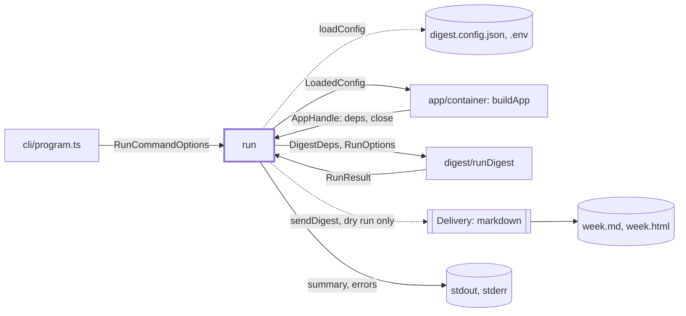
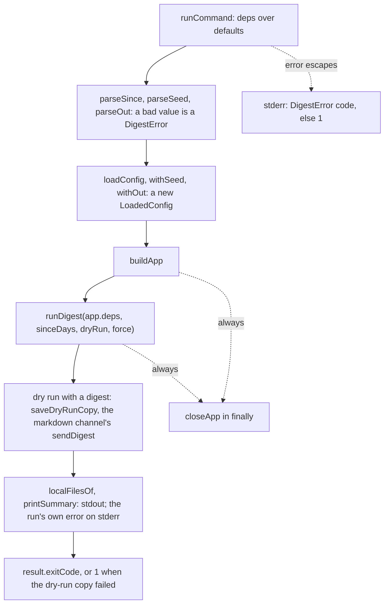

# Run command

> `digest run`: one full digest run, then a short report and the run's exit code. Entry:
> `runCommand(options, deps?) → exit code` (`run.ts`). It checks the flags, builds the app and calls
> `runDigest` (`digest/`); the pipeline is not here. Tests replace `RunCommandDeps` (config loader,
> `buildApp`, `runDigest`, stdout, stderr). No port. Reader page: `docs/features/cli.md`.

## Context

## Flow

- Summary lines: `Week`, `Status`, `Items`, `Winner`, `Duration`, then `Digest` (the run folder's
  `digest.md`, when the run has one), `Markdown` and `HTML` (only files that are there), a line
  per failed source and rejected draft, a dry-run or skipped note and the `kept` reason.
- The exit code is the run's own: sent, dry-run and skipped 0, quiet 3, blocked 2, failed 1.

## Rules

- Everything printed passes `redactSecrets` with the secrets of the loaded config. Until the config
  loads the list is empty, so an error from the loader is printed as it is.
- A dry run still writes the digest: `saveDryRunCopy` gives the message to the `markdown` channel
  only (found by `id`), so email and Slack get nothing; a file is not a send. It writes nothing when
  the run kept the week's earlier files or there is no markdown channel, and it never throws. A
  failed write prints `Error: could not write the dry-run digest to <dir>` after the summary and
  exits 1, whatever the run's own code was.
- File lines list what is on disk. A resumed week whose markdown channel took the digest in another
  folder prints no path; the HTML line appears only when the page exists.
- `--since` is `Nd` with 1 to 31 days, `--seed` a whole number of 0 or more (checked again here:
  library callers skip commander), `--out` not blank. `withSeed` and `withOut` return new configs.
- The app is closed in `finally`. A failed close prints `Warning: could not close the app cleanly`
  and changes neither the exit code nor the run's error.

## Files

| File     | Role                                                                                   |
| -------- | -------------------------------------------------------------------------------------- |
| `run.ts` | `runCommand`, `RunCommandOptions`, `RunCommandDeps`, flag checks, dry-run copy, report |

Tests are split by case: `run.test.ts` (wiring, `--since`, exit codes, closing, default deps),
`run.summary.test.ts` (summary, rejected drafts, secrets), `run.out.test.ts` (`--out`, local files),
`run.dryRun.test.ts` (the dry-run copy: temp folders, `CapturingDelivery`, the real markdown
channel). `__fixtures__/runHarness.ts` holds the scripted app and the captured output.

## Gotchas

- `run.ts` is 291 lines; the cap is 300. Extract a subfolder (the summary, the dry-run copy) before
  adding code.
- Two adapter imports are on purpose: `markdownFileOptions`, `markdownFolder` and `digestFilePaths`
  (`delivery/adapters/markdownFile`) give the paths the channel writes to, and `DIGEST_FILE`
  (`store/adapters/runFolders`) names the run folder's `digest.md`. The `RunStore` port returns file
  text, not paths. See `../CLAUDE.md`.
- `formatRunDuration` comes from `../history/history`. `test/integration/harness/runCli.ts` calls
  `runCommand`; tests pin the labels, `Dry run: nothing was sent.` and the error lines.
- The report does not strip control characters, unlike `show` and `fetch`: its fields (sources,
  rejected drafts, run error) are composed in code, never copied from a feed or a model.
