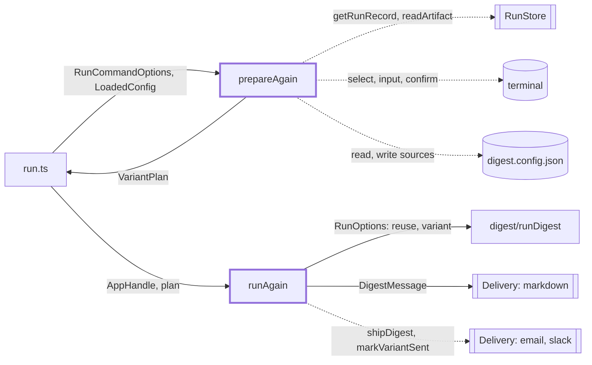
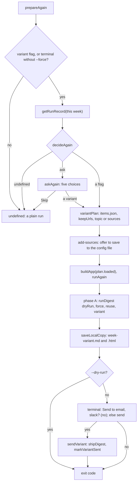

# Run again

> What `digest run` does when the week already has a digest: a menu (or a flag) picks a second run
> that reuses the saved items, builds a postfixed copy and offers to send it. Entry:
> `prepareAgain(options, loaded, io, report) → VariantPlan | undefined` (`prepare.ts`) and
> `runAgain(app, io, plan) → exit code` (`runAgain.ts`). Parent: `../CLAUDE.md`.

## Context

## Flow

- The menu is only for a terminal, without `--force`, and a week whose record is `sent` or
  `dry-run`. Flags work for any record, as long as the week has `items.json`.
- Skip is today's behaviour: a sent week is skipped by `runDigest`, a dry-run week runs in full.

## Rules

- Flags win and exclude each other (`DigestError` naming them). `--perspective` and `--add-source`
  are cleaned and validated before the app is built, so a bad value fetches nothing.
- The config for added sources is applied before `buildApp` (`withSources`). The config file is
  written only after a yes, via read-modify-write that keeps other keys and passes `ConfigSchema`.
  Without a terminal nothing is saved; a one-line hint says so.
- A variant is built with `dryRun: true, force: true`: it never sends in phase A. The send goes to
  the configured non-Markdown channels only, after a question that defaults to no; without a
  terminal a variant flag counts as the yes (`--dry-run` keeps it on disk).
- `markVariantSent` runs only when a non-Markdown channel took the digest; its URLs come from the
  variant's view, else from the links in its Markdown.
- Ctrl+C in a menu question prints `Cancelled. Nothing was run.` and exits 1; at the send question
  it sends nothing and keeps the build's exit code.
- The topic is terminal text: `printableLine`, no `"`, 1 to 200 characters.

## Files

| File             | Role                                                                      |
| ---------------- | ------------------------------------------------------------------------- |
| `prepare.ts`     | `prepareAgain`: record lookup, decision, menu, plan, save offer, cancel   |
| `askAgain.ts`    | `decideAgain` (flags, menu rule), `askAgain` (the five choices)           |
| `variant.ts`     | `variantPlan`: saved items, `keepUrls`, `reuse`, `RunVariant`, config     |
| `newSources.ts`  | `parseSourceList`, `detectKind`, `sourceIdFor`, `askNewSources`           |
| `saveSources.ts` | `saveSources` (config read-modify-write), `confirmSave`                   |
| `perspective.ts` | `askPerspective`, `suggestedPerspectives`, `cleanTopic`, local topic list |
| `sendConfirm.ts` | `confirmSend`, `sendChannelIds`, `sendVariant`                            |
| `runAgain.ts`    | The two phases, the summary, the exit code                                |
| `links.ts`       | `linkUrls`: URLs of the Markdown links in a digest                        |
| `types.ts`       | `RunPrompts`, `AgainChoice`, `AgainFlags`, `AgainOptions`, `FileIo`       |

Tests sit next to each file; `../run.again.test.ts` drives `runCommand` end to end with
`scriptedPrompts`, `MemoryRunStore` and `CapturingDelivery` from `../__fixtures__/runHarness.ts`.

## Gotchas

- Prompt messages are pinned by tests (`Week <id> already has a sent digest. What now?`,
  `Source URLs (comma-separated)`, `Save to <file> for future weeks?`, `Send to email, slack?`).
- `SUGGESTED_PERSPECTIVES` is a local copy; switch it to `TOPICS` from `src/sources/topics/catalog.ts`
  when that catalog lands (TODO in `perspective.ts`).
- A partly failed send is not resumable by `resumeDelivery`: the CLI names the channels missed and
  the user runs the variant again.
- On a sent week a disk-only variant leaves only the postfixed `.md` and `.html` files.
- `run.ts` looks the record up only when a flag is set or a terminal can answer, so a plain
  scheduled run touches no extra file.
