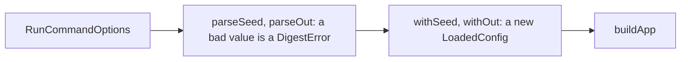

# Run flags

> Checks the `--seed` and `--out` values of `digest run` and applies them to a loaded config.
> Entry: `parseSeed`, `withSeed`, `parseOut`, `withOut`, `withSources` (`flags.ts`). No port. Parent: `../CLAUDE.md`.

## Flow

## Rules

- `with*` return a new `LoadedConfig`; with no value they return the one they got: callers and tests
  compare by identity.
- `parseSeed` is checked again here: commander checks it, library callers skip commander.
- A blank `--out` is refused: the schema needs a real path.

## Files

| File            | Role                                                                                    |
| --------------- | --------------------------------------------------------------------------------------- |
| `flags.ts`      | `parseSeed`, `withSeed`, `parseOut`, `withOut`, `withSources` (sources added for a run) |
| `flags.test.ts` | Unit cases; the end-to-end flag cases stay in `../run.test.ts` and `../run.out.test.ts` |

## Gotchas

- The error texts (`Invalid --seed`, `Invalid --out`) are pinned by tests.
