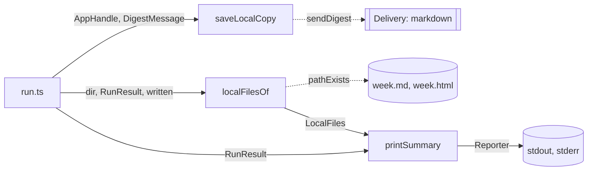

# Run summary

> What `digest run` prints and writes locally after a run: the summary lines, the list of local
> digest files and the dry-run copy. Entry: `printSummary` (`summary.ts`), `localFilesOf`
> (`localFiles.ts`), `saveLocalCopy` (`localCopy.ts`). No port. Parent: `../CLAUDE.md`.

## Flow

## Rules

- `saveLocalCopy` gives the message to the `markdown` channel only (found by `id`) and never
  throws: a failed write comes back as `error`.
- `localFilesOf` lists what is on disk. A path it cannot check is left out, so the summary and the
  exit code stay: the listing is a courtesy.
- The HTML line appears only when the page exists.

## Files

| File            | Role                                                                |
| --------------- | ------------------------------------------------------------------- |
| `summary.ts`    | `printSummary`, `statusNote`, `keptNote`, `Reporter`, `LABEL_WIDTH` |
| `localFiles.ts` | `localFilesOf`, `LocalFiles`                                        |
| `localCopy.ts`  | `saveLocalCopy`, `LocalCopy`                                        |

Tests sit next to each file; the folder cases are also covered by `../run.*.test.ts`.

## Gotchas

- Labels, `Dry run: nothing was sent.` and the error lines are pinned by `run.*.test.ts` and
  `test/integration/harness/runCli.ts`.
- `localFiles.ts` imports `delivery/adapters/markdownFile` for the paths the channel writes to;
  see `../CLAUDE.md`.
