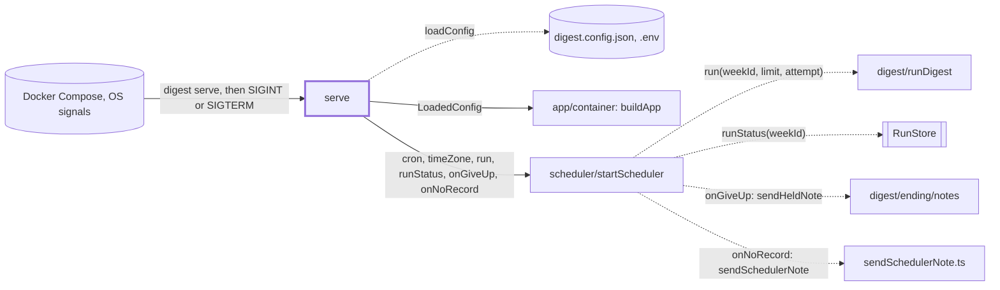
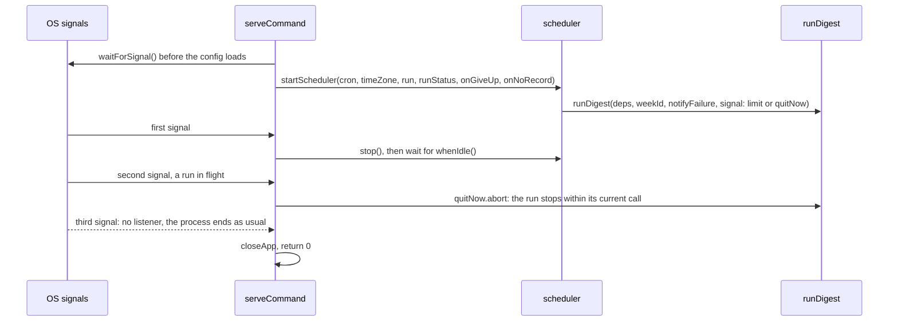

# Serve command

> `digest serve`: runs the weekly scheduler in the foreground until a signal stops it (the Docker
> Compose service). Entry: `serveCommand(options, overrides?) → exit code` (`serve.ts`). It hands the
> scheduler the closures that run a week; the cron loop is `scheduler/`. Tests replace
> `ServeCommandIo` (config, app, scheduler, `runDigest`, signals, stderr). No port.

## Context

## Flow

- Startup logs `Scheduler started` with the next run (a warning when `schedule.cron` has none); the
  stop logs `Scheduler stopping`, and a second signal `Second signal: …`.
- Exit 0 after any clean stop, a second signal included. A `DigestError` (a config error, a
  scheduler that cannot start) goes to stderr with its code; any other error is rethrown after the
  app is closed, and `index.ts` prints it and exits 1.

## Rules

- Listen first: `waitForSignal()` runs before `loadConfig`, so a signal during startup does not meet
  the default handler. Closing the app under a running digest would cut its traces and store, so the
  first signal waits for the run in flight.
- `waitForShutdownSignal` removes its listeners once a signal arrives. That is why a third signal
  ends the process: nothing listens. `untilIdle` cancels its own listener when the run ends first.
- The run's signal is `AbortSignal.any([limit, quitNow.signal])`: `limit` is the scheduler's time
  limit (3 hours by default), `quitNow` the second signal. The fetchers, the guards and every model
  call stop within one call; a delivery that has started finishes before the run checks it.
- `notifyFailure` follows the scheduler's attempt: false on a failed attempt that will be retried
  (`failedRetry: DEFAULT_FAILED_RETRY`, two more tries 30 minutes apart; the scheduler has none by
  default), so a failed week sends one note. `onGiveUp` sends the held note with `sendHeldNote` when
  no retry follows (`stop()` cancels a waiting retry, the lock stays held, the run throws).
  `onNoRecord` sends the scheduler's own note (`sendSchedulerNote`) to every channel for a week
  that has no run record: its run threw on every attempt, or another run held the lock for the
  whole budget. The text comes from the scheduler (week and error code, never error text).
- The config is read once: a change to `digest.config.json` or `.env` needs a restart.
- `closeApp` logs a failing close and does not throw: it must not hide how the service ended.

## Files

| File                   | Role                                                                                     |
| ---------------------- | ---------------------------------------------------------------------------------------- |
| `serve.ts`             | `serveCommand`, `ServeCommandIo`, `waitForShutdownSignal`, the run closures, `untilIdle` |
| `sendSchedulerNote.ts` | `sendSchedulerNote`: the scheduler's own failure note to every channel, best effort      |

`serve.test.ts` covers wiring, shutdown order, the run signal, failures and `waitForShutdownSignal`
(real `SIGINT` and `SIGTERM` emitted on `process`); `serve.notify.test.ts` the attempt, the held
note and the scheduler's own note, with `CapturingDelivery`.

## Gotchas

- The tests pin the order: signal listener before config, then `stop()`, wait, close, return 0. The
  second-signal tests count the cancel signals handed to `waitForSignal`; keep the call order.
- `sendHeldNote` comes from `digest/ending/notes/failureNotes.ts` and `DEFAULT_FAILED_RETRY` from `scheduler/scheduler`:
  renaming either breaks this command. `sendSchedulerNote` repeats the small channel loop of that
  file's private `broadcastNote`: it has no run record to build a `sendHeldNote` call from. A new
  scheduler option reaches the service only when it is passed to `startScheduler` here.
- The service logs through `deps.logger`; stderr carries only a `DigestError`. There is no summary.
