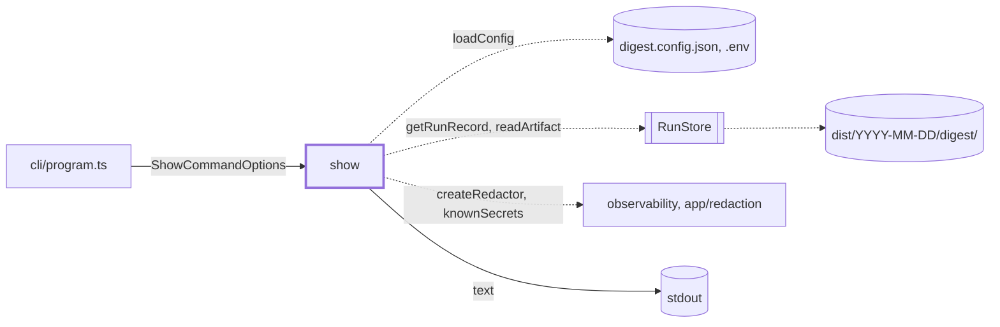
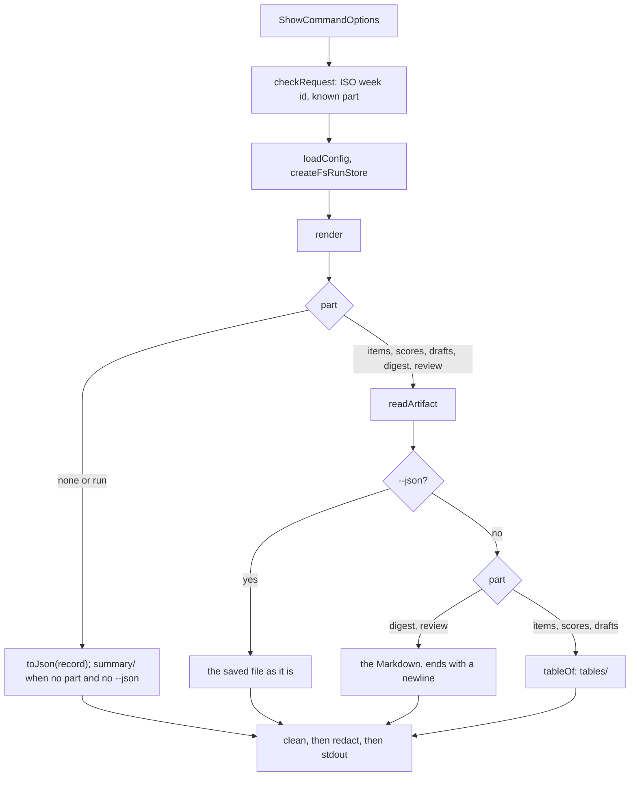

# Show

> `digest show <week>`: prints a saved run, or one part of it, from the week's `dist/<monday>/digest/`
> folder. Entry: `showCommand(options, deps?) → ExitCode` (`show.ts`). It builds no app, takes no
> lock and calls no model; it reads through the `RunStore` port.

## Context

## Flow

- A part with no file and no record fails with `No saved run for <week>`; with a record, with
  `Week <week> has no <file> (run status: <status>)`. A file without a record still prints.
- `scores` reads four files: `scores.json`, `items.json` (titles; absent is fine), `drafts.json` and
  the record's winner (the status column). `drafts` reads `drafts.json` and the record's outcomes.

## Rules

- All output goes through `clean`, then the redactor, `--json` included: saved files hold feed text
  and may hold a secret.
- `--json` makes `render` return the saved file as it is, and `toJson(record)` for no part or
  `run`: scripts parse it.
- The week id must match `WEEK_ID_PATTERN` before it reaches the store, so a path like `../etc`
  never touches disk.
- An unknown part fails with the valid ones listed: `items, scores, drafts, digest, run, review`.
- A file that cannot be read fails with its name (`items.json is not valid JSON`), not a stack.
- Exit code: 0 on success; a `DigestError` gives its own code (`ShowError`: 1), any other error 1.

## Files

| File / folder  | Role                                                                         |
| -------------- | ---------------------------------------------------------------------------- |
| `show.ts`      | `showCommand`, `ShowCommandDeps`, `checkRequest`, `render`, `tableOf`        |
| `showError.ts` | `ShowError`: a request that cannot be answered; its message is printed as is |
| `parseFile.ts` | `parseFile`: a saved JSON file to a typed value, or a `ShowError` naming it  |
| `tables/`      | The `items`, `scores` and `drafts` tables. See `tables/CLAUDE.md`            |
| `summary/`     | The default summary of a run record. See `summary/CLAUDE.md`                 |

Tests sit next to each file; `show.test.ts` drives `showCommand` with `MemoryRunStore`.

## Gotchas

- `cli/program.ts` (frozen) imports `showCommand`. `show.ts` takes `toJson` from `digest/ending/runFiles/runFiles.ts`;
  `summary/summary.ts` takes the duration helpers from `cli/history/history`.
- Tests pin the table headers and the summary labels (`Winner:`, `Guards off:`).
- Errors go to stderr as they are, not cleaned or redacted. `parseFile` repeats `JSON.parse`'s
  message, which can echo a few characters of the file.
- A field added to `RunRecord` shows up only after `summary/summary.ts` prints it.
- `tables/` and `summary/` never import `show.ts`; shared pieces sit beside it (`showError.ts`,
  `parseFile.ts`).
