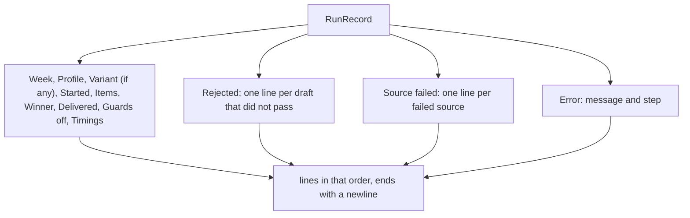

# Show summary

> The default text of `digest show <week>`: one line per fact of the saved `RunRecord`. Entry:
> `summary(record) → string` (`summary.ts`).

## Flow

## Rules

- The fixed lines always print, with a stand-in for a missing fact: `none` for no winner, no
  `deliveredTo` and no disabled guard; `-` for no timings and for a draft rejected by nothing.
- Problems come after the fixed lines, the error last: that is where a reader looks.
- `Started:` shows the saved start time and the run's length from `formatRunDuration`, the same
  figure `digest history` prints.
- A failed source's error is cut at 200 characters (`MAX_ERROR_CHARS`).
- A record with `counts.guardedCandidates` (0 when the run ended before that step) ran the model
  guards after `process`: `Items:` says `after the rule guard` and `N selected (model guards checked
M)`. Older records, and runs with `models.rescoreWithWriter`, say `after guards`.
- A record with `variant` (a second run of the week) gets a `Variant:` line after `Profile:`:
  `enriched`, `enriched (added: id1, id2)` (kind `add-sources`), `complete` or `perspective: <topic>`.
  No line without it, so older output is unchanged. The topic and ids are operator text; `show.ts`
  cleans control and bidi characters from the whole text.
- The summary redacts nothing: `show.ts` cleans and redacts the whole text.

## Files

| File         | Role                                           |
| ------------ | ---------------------------------------------- |
| `summary.ts` | `summary`: the lines above for one `RunRecord` |

The test builds records with `makeRunRecord` and pins the text line by line.

## Gotchas

- Labels are padded by hand to 12 characters; `Source failed:` is longer and not aligned.
- A new optional `RunRecord` field is not printed until a line is added here.
