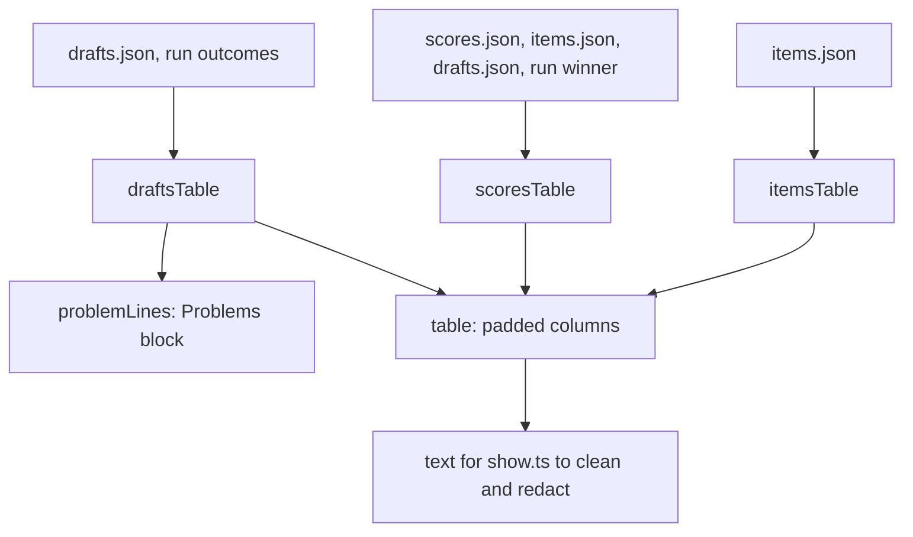

# Show tables

> The text tables behind `digest show --part items|scores|drafts`. Entry: `itemsTable(items)`,
> `scoresTable(week, raw, store)`, `draftsTable(week, raw, store)`; each returns the text to print.

## Flow

- `scoresTable` also lists the items that have no score as `dropped before scoring (input guard)`.
- `draftsTable` lists the record's outcomes first, then writers only `drafts.json` knows.

## Rules

- Feed and model text goes through `cell`: control and format characters become spaces and the cell
  is cut at 70 characters. A URL is not cut: a cut URL is useless.
- A score row says `in digest` only for an item in the winner's draft; with no winner, or no
  `drafts.json`, every row says `scored, not picked`.
- `Items` is 0 for a writer that has no draft in `drafts.json`; `Judge` is `-` without a score.
- `OutcomeNotesSchema` drops a malformed `failures` or `rejections` list instead of failing: the
  table still prints.

## Files

| File              | Role                                                                                |
| ----------------- | ----------------------------------------------------------------------------------- |
| `table.ts`        | `table`, `cell`, `clean`, `formatScore`, `MAX_CELL_CHARS`; `clean` is for `show.ts` |
| `items.ts`        | `itemsTable`: source, title, date, URL                                              |
| `scores.ts`       | `scoresTable`, `digestItemIds` (item ids of the winning draft)                      |
| `drafts.ts`       | `draftsTable`: writer, passed, rejected by, items, judge score                      |
| `problemLines.ts` | `problemLines` (cuts each problem text at 200), `OutcomeNotesSchema`                |

Tests sit next to each file and use `MemoryRunStore`.

## Gotchas

- Tests pin the headers, the two-space column gap and the lack of trailing spaces.
- `clean` keeps newline, tab and carriage return; `cell` turns them into spaces.
