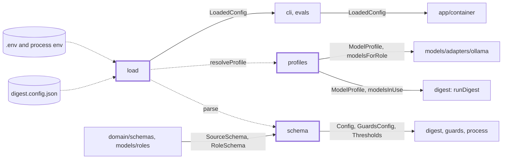
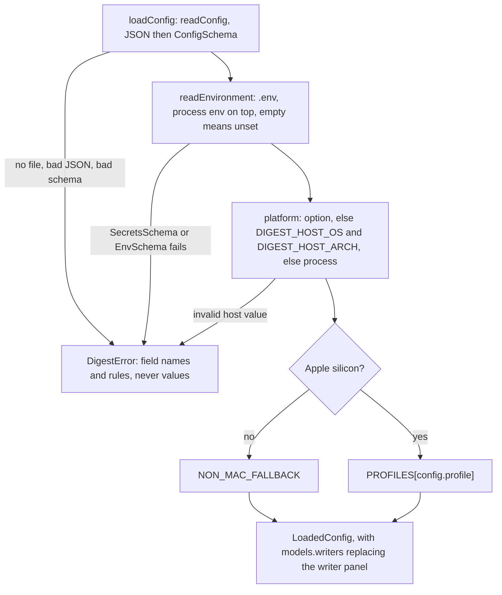

# Config

> Everything the user can tune: reads and checks `digest.config.json` and `.env`, keeps secrets apart
> from settings, and turns a profile name into model tags for the machine at hand.
> Entry: `loadConfig(options) → Promise<LoadedConfig>` (`load.ts`). It owns no port.

## Context

## Flow

- Writers override: more than one writer gets the profile's judge, else `EVAL_JUDGE` (`clef`); one
  writer means no judge and no select step. The profile table is in `docs/configuration/profiles.md`.
- Tags per role: `modelsForRole` (`write` returns the panel), `requiredModels`, `modelsByRole`.
  `modelsInUse` drops a guard role whose checks are all off, so doctor does not ask for its model.
- Limits (default): `topN` 3-5 (5), `windowDays` 1-31 (7), `maxItemsPerSource` 1-100 (20), `dedupeWeeks`
  0-12 (4), `keepWeeks` at least 1 (12), `models.retries` 0-5 (2), `models.seed` 42, role timeout at
  least 1,000 ms, `profile` `quality`, `schedule.cron` `45 7 * * 1`, thresholds `minRelevance` 1.5,
  `maxHype` 0.6, `maxMinorRelease` 0.75, `guardFlag` 0.35.
- Folders: `dataDir` (`dist`) holds everything the project produces, laid out by `store/layout.ts`.
  `delivery.markdown.dir` has no default: unset, the Markdown files go to each week's `digest/` folder.

## Rules

- Secrets come from `.env` or the process environment only, never `digest.config.json`.
  `SLACK_WEBHOOK_URL` must be https (its secret path must not travel in clear). A source URL with
  `user:pass@` is refused: `fetch` echoes the whole URL into errors, logs and run records.
- Error messages name fields and rules, never the rejected values (`z.prettifyError`).
- A new setting needs a default, so existing `digest.config.json` files still load.
- A source id must not be `digest`: a source's folder shares the day folder with the week's
  `digest/` (`isReservedSourceId`, `store/layout.ts`).
- `keepWeeks >= dedupeWeeks`: a pruned week drops out of cross-week dedupe. `writers` are unique:
  outcomes and scores are keyed by tag. `focusAreas` are unique, 1-25: decision models take 26 options.
- `mergeEnvText` (for `digest init`) changes only the keys asked for, keeps comments and line endings,
  and re-reads its result with the loader's parser (`node:util` `parseEnv`). If that differs it throws
  and nothing is written. `formatEnvValue` refuses a value it cannot quote.

## Files

| File          | Role                                                                                                 |
| ------------- | ---------------------------------------------------------------------------------------------------- |
| `schema.ts`   | `ConfigSchema`, `SecretsSchema` (`SECRET_KEYS`), `EnvSchema` and their types                         |
| `profiles.ts` | `PROFILES`, `MODEL_TAGS`, `NON_MAC_FALLBACK`, `resolveProfile`, `EVAL_JUDGE`, role helpers           |
| `load.ts`     | `loadConfig`, `platformOf`, `resolveHostPlatform`, `redactSecrets`, `mergeEnvText`, `formatEnvValue` |

Tests sit next to each file. `load.test.ts` reads `test/fixtures/config/` and pins the error texts.

## Gotchas

- `schema.ts` and `profiles.ts` are frozen (`.claude/rules/parallel-work.md`): change them on `main`.
  A `MODEL_TAGS` change alters what `digest doctor` asks users to pull. A setting users should know
  about goes in `docs/configuration/` and `docs/reference/config-keys.md`.
- The keys of `guards.input|output.checks` decide which guards the guard step runs (`planGuards`).
- `EVAL_JUDGE` in `profiles.ts` is a model tag; the env variable `EVAL_JUDGE` (`EnvSchema`) is the tag
  `digest eval` uses to score digests.
- `redactSecrets` here takes the `Secrets` object and does not add the Slack webhook path
  (`app/knownSecrets` does); `delivery/adapters/redact.ts` has another one over `string[]`.
