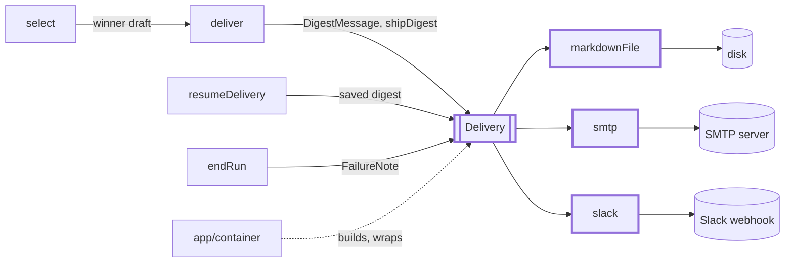
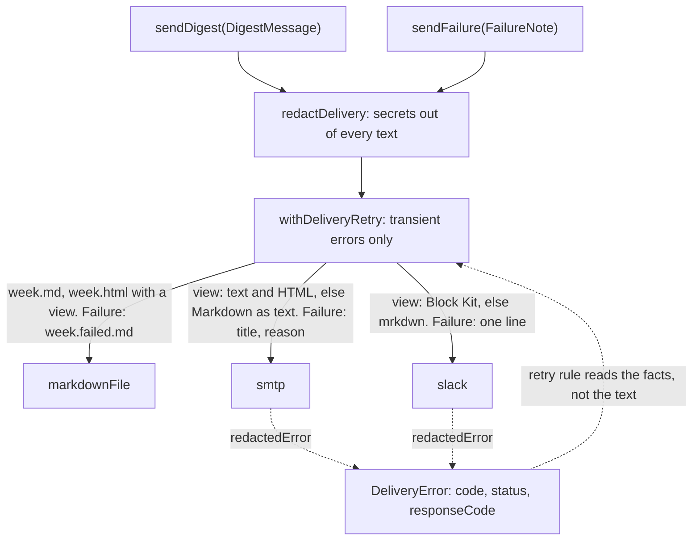

# Delivery

> Hands one finished digest, or one failure note, to a channel: file, email or Slack. Port:
> `Delivery` (`sendDigest(DigestMessage)`, `sendFailure(FailureNote)`). The `deliver` step and the
> loop over channels live in `src/digest` (`shipDigest`); this folder owns the port and adapters.

## Context

## Flow

- `shipDigest` (`digest/ending/shipping/shipping.ts`) tries each channel in turn and never throws.
  A failure ends the run `failed` naming the channels that got it; `resumeDelivery`
  (`digest/resume/resumeDelivery.ts`) sends the saved `digest.md` to the rest. A failure note is best effort: a channel that fails is logged.

## Rules

- The view is built once (`render/layout`); channels only render it. No view: they show `markdown`.
- Model and collected text is made safe per channel: one line without invisible characters
  (`render/visibleLine`, both; text that keeps its lines, such as the Markdown file, the mail without
  a view, the failure note and the Slack fallback, uses `render/visibleText`), HTML-escaped
  (email), `& < >` escaped (Slack, so `<!channel>` cannot appear). Only http(s) URLs without a user name or password become
  links: `https://github.com@evil.example` goes elsewhere than it reads. Details: `adapters/email/`,
  `adapters/slackBlocks/`. The mail Subject is model text too: `digestMessage`
  (`digest/ending/shipping`) puts the headline through `visibleLine`, in a new run and in a resume.
- SMTP: `requireTLS` on by default; connect 15 s, greeting 15 s, socket 30 s; recipients copied at
  creation. A mail some recipients refused (the server took it for the others) is a failed send,
  not retried: a resume can give the accepting recipients a second copy.
  Slack: https only, 15 s, `redirect: 'error'`, body redacted (the path is the secret).
- Errors come from `redactedError`: a new `DeliveryError` with a copy of the cause chain, secrets
  replaced, never the original. Its retry facts are identifiers or integers; the retry rule reads them.
  The one other error, `refusedRecipientsError` (a partly refused mail), has no facts, so it is not retried.
- Markdown channel: the week id must match `WEEK_ID_PATTERN` (it becomes a file name). The folder is
  `delivery.markdown.dir`, else the week's `digest/` folder (`markdownFileOptions`, `markdownFolder`).
  The HTML is rendered and the old `.html` removed before the writes, which are atomic: the two
  files never disagree. After them `sendDigest` removes the week's `.failed.md`, so a failure note
  from an earlier attempt does not stay beside the sent digest.

## Files

| File                    | Role                                                                                            |
| ----------------------- | ----------------------------------------------------------------------------------------------- |
| `Delivery.ts`           | The port, `DigestMessage`, `FailureNote`                                                        |
| `deliveryId.ts`         | `DeliveryIdSchema`, `DeliveryId`: channel ids kept in `run.json`                                |
| `adapters/`             | The channels: `markdownFile.ts` (always on), `smtp.ts`, `slack.ts`; see `adapters/CLAUDE.md`    |
| `adapters/email/`       | `renderEmailText`, `renderEmailHtml` from a view; see its `CLAUDE.md`                           |
| `adapters/slackBlocks/` | `toSlackBlocks`; `escapeSlack`, `toSlackMrkdwn`; see its `CLAUDE.md`                            |
| `adapters/errors/`      | `DeliveryError`, `redactedError`, `refusedRecipientsError`, `failureTitle`; see its `CLAUDE.md` |

## Gotchas

- Email layout: edit `adapters/email/`, run its renderer tests with `UPDATE_GOLDEN=1`, read the
  diff. The Slack golden `digest-blocks.json` is edited by hand.
- `DigestView` lives in `render/digestView.ts`; the channels, `digest/` (shipping, resume), `app/redaction`
  and `cli/preview` import it there (`cli/preview` also calls the email and Slack renderers);
  `cli/run` uses `digestFilePaths`, `markdownFolder`.
- A new channel needs its id in `Delivery.id` and `DeliveryIdSchema`, an entry in
  `DeliveryConfigSchema` (frozen `config/schema.ts`) and a branch in `app/container.ts`.
- `store` prune keeps the files named `<week>.*` in a week's `digest/` folder: keep that prefix on
  every file this channel writes there.
- `deliveryRetry.test.ts` imports `app/retryingDelivery`: change the facts and the rule together.
  A send can still land twice if the server took it, then answered 429/5xx or SMTP 421/450/451.
