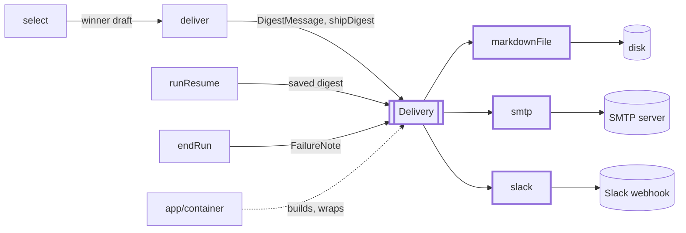
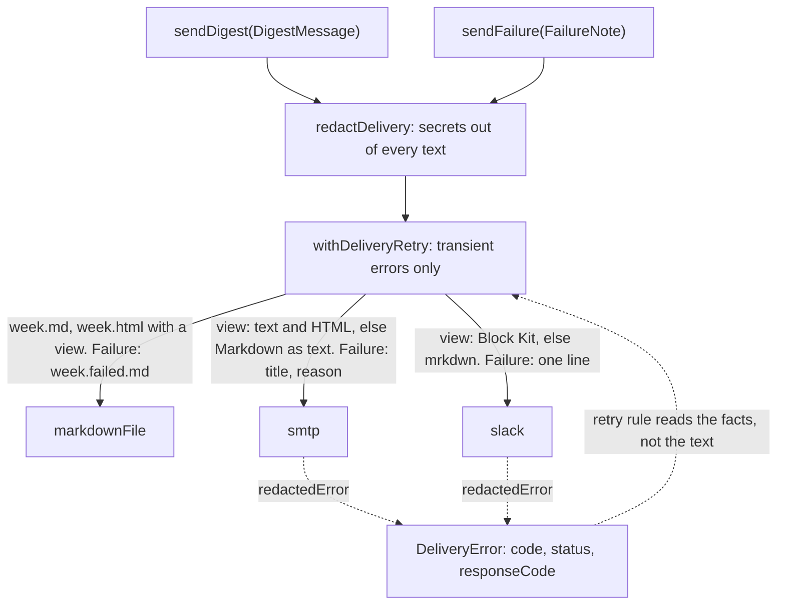

# Delivery

> Hands one finished digest, or one failure note, to a channel: file, email or Slack. Port:
> `Delivery` (`sendDigest(DigestMessage)`, `sendFailure(FailureNote)`). The `deliver` step and the
> loop over channels live in `src/digest` (`shipDigest`); this folder owns the port and adapters.

## Context

## Flow

- `shipDigest` (`digest/runEnding.ts`) tries each channel in turn and never throws. A failure ends
  the run `failed` naming the channels that got it; `runResume` sends the saved `digest.md` to the
  rest. A failure note is best effort: a channel that fails is logged.

## Rules

- The view is built once (`render/layout`); channels only render it. No view: they show `markdown`.
- Model and collected text is made safe per channel: one line, HTML-escaped (email), `& < >` escaped
  (Slack, so `<!channel>` cannot appear). Only http(s) URLs without a user name or password become
  links: `https://github.com@evil.example` goes to another host than it reads. Email HTML: inline
  styles only, no script, style block, remote image or font.
- Slack: 50 blocks, 3,000 chars per section, 150 in the header; no empty header or context text.
- SMTP: `requireTLS` on by default; connect 15 s, greeting 15 s, socket 30 s; recipients copied at
  creation. Slack: https only, 15 s, `redirect: 'error'`, body redacted (the path is the secret).
- Errors come from `redactedError`: a new `DeliveryError` with a copy of the cause chain (5 levels
  at most), secrets replaced, never the original. Retry facts (`code`, `originalCode`, `status`,
  `responseCode`, `timeoutType`) are plain identifiers or integers; the retry rule reads them.
- Markdown channel: the week id must match `WEEK_ID_PATTERN` (it becomes a file name). The folder is
  `delivery.markdown.dir` when set, else the week's `digest/` folder in the data folder
  (`markdownFileOptions`, `markdownFolder`). The HTML is rendered first and the old `.html` removed
  first, writes are atomic: the two files never disagree.

## Files

| File                                        | Role                                                             |
| ------------------------------------------- | ---------------------------------------------------------------- |
| `Delivery.ts`                               | The port, `DigestMessage`, `FailureNote`, `DigestView`           |
| `deliveryId.ts`                             | `DeliveryIdSchema`, `DeliveryId`: channel ids kept in `run.json` |
| `adapters/markdownFile.ts`                  | Always-on file channel, `digestFilePaths`, `markdownFolder`      |
| `adapters/smtp.ts`                          | Email through nodemailer; `MailTransport` is injectable          |
| `adapters/slack.ts`                         | Slack incoming webhook; `fetch` is injectable                    |
| `adapters/emailRender.ts`                   | `renderEmailText`, `renderEmailHtml` from a view                 |
| `adapters/slackBlocks.ts`, `slackFormat.ts` | `toSlackBlocks`; `escapeSlack`, `toSlackMrkdwn`                  |
| `adapters/failureNote.ts`                   | `failureTitle`, `failureOneLiner` (300 chars)                    |
| `adapters/deliveryError.ts`, `redact.ts`    | `DeliveryError`, facts; `redactSecrets`, `redactedError`         |

## Gotchas

- Email layout: edit `emailRender.ts`, run its test with `UPDATE_GOLDEN=1`, read the diff
  (`__fixtures__/email/`). The Slack golden `digest-blocks.json` is edited by hand.
- `DigestView` is imported by `render/`, `evals/metrics.ts` and `cli/preview` (which also calls
  `emailRender`, `slackBlocks`); `cli/run` uses `digestFilePaths` and `markdownFolder`.
- A new channel needs its id in `Delivery.id` and `DeliveryIdSchema`, an entry in
  `DeliveryConfigSchema` (frozen `config/schema.ts`) and a branch in `app/container.ts`.
- `store` prune keeps the files named `<week>.*` in a week's `digest/` folder: keep that prefix on
  every file this channel writes there.
- `deliveryRetry.test.ts` imports `app/retryingDelivery`: change the facts and the rule together.
  A send can still land twice if the server took it, then answered 429/5xx or SMTP 421/450/451.
