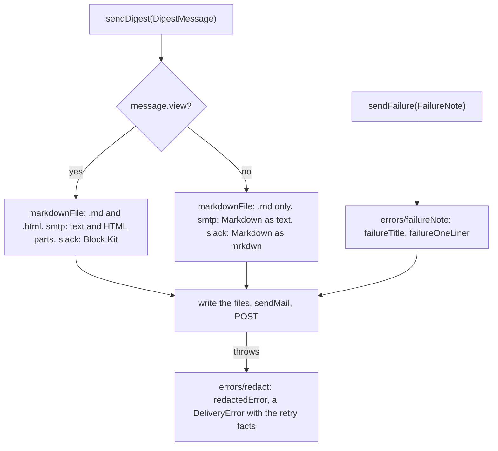

# Delivery adapters

> The three `Delivery` channels: `createMarkdownFileDelivery(options)` (`markdownFile.ts`),
> `createSmtpDelivery(options)` (`smtp.ts`), `createSlackDelivery(options)` (`slack.ts`). Each entry
> file only does the I/O; the rendering and the error handling sit in `email/`, `slackBlocks/` and
> `errors/`.

## Flow

- `markdownFile`: always on. Config `delivery.markdown.dir` (optional); no secret. A failure note is
  `<week>.failed.md`: the title, the step and the error.
- `smtp`: config `delivery.email` (`host`, `port`, `secure`, `requireTLS`, `user`, `from`, `to`);
  `SMTP_PASSWORD` from `.env`. A failure note is a mail titled `failureTitle`, with the reason.
- `slack`: config `delivery.slack.enabled`; `SLACK_WEBHOOK_URL` from `.env`, https only. A failure
  note is one `failureOneLiner` line as mrkdwn.

## Rules

- Recipients, host, webhook and password arrive as options from `app/container`: an adapter reads
  no config file or `.env`, so nothing from model output can pick a recipient or an endpoint.
- `smtp` and `slack` name their own secrets to `redactedError`: the SMTP password, the Slack webhook
  in every spelling (raw, normalised, secret path). The Slack body is redacted before the POST.
- Network and mail are injectable (`createTransport`, `fetch`): no test opens a socket.
- `email/`, `slackBlocks/` and `errors/` never import an entry file or each other. `email/` and
  `slackBlocks/` are pure: a view in, text out.
- A failed SMTP or Slack call throws the `DeliveryError` of `redactedError`; a non-2xx Slack answer
  is a `DeliveryError` with its `status`. A non-https webhook, an invalid week id and a file error
  throw as they are: none of their texts holds a secret.

## Files

| File              | Role                                                                                       |
| ----------------- | ------------------------------------------------------------------------------------------ |
| `markdownFile.ts` | `createMarkdownFileDelivery`, `markdownFileOptions`, `markdownFolder`, `digestFilePaths`   |
| `smtp.ts`         | `createSmtpDelivery`, `SmtpOptions`, `MailTransport`, `MailMessage`                        |
| `slack.ts`        | `createSlackDelivery`, `SlackOptions`                                                      |
| `email/`          | The mail as text and as HTML. See `email/CLAUDE.md`                                        |
| `slackBlocks/`    | Block Kit from a view; Markdown as mrkdwn. See `slackBlocks/CLAUDE.md`                     |
| `errors/`         | `DeliveryError` and its facts, secret redaction, failure note text. See `errors/CLAUDE.md` |

Tests sit next to each file. Goldens and fixtures are in the folders' `__fixtures__/`.

## Gotchas

- `markdownFile.test.ts` and `markdownFile.html.test.ts` mock `shared/atomicFile`: moving
  `writeFileAtomic` breaks them.
- `smtp.mime.test.ts` builds the real MIME with nodemailer's stream transport, so it pins the
  headers and parts. `smtp.test.ts` mocks `nodemailer` instead.
- `deliveryRetry.test.ts` runs these adapters through `app/retryingDelivery`: a new retry fact or
  error shape needs both sides changed.
