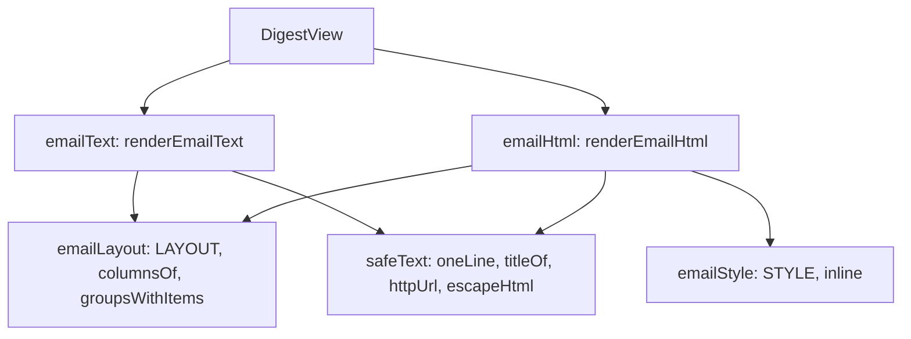

# Email render

> The digest view as the two parts of a mail: plain text and one self-contained HTML page. Entries:
> `renderEmailText(view) → string` (`emailText.ts`), `renderEmailHtml(view) → string`
> (`emailHtml.ts`). Pure: no port, no I/O.

## Flow

## Rules

- Every model or collected string goes through `oneLine` (and `escapeHtml` in the HTML): breaks,
  control and bidi characters cannot fake a bullet or a heading, or reorder the text.
- Only `httpUrl` makes a link or a printed URL: absolute http(s), no credentials, no whitespace or
  control characters. Anything else shows the title as plain text.
- The HTML has inline styles only (no script, style block, form, remote image or font). The page,
  the card and every table cell set their own background and text colour: a client that darkens
  the mail cannot show light text on a light page.
- A group without items is skipped. A footer shows only when text is left after `oneLine`.

## Files

| File             | Role                                                                                          |
| ---------------- | --------------------------------------------------------------------------------------------- |
| `emailText.ts`   | `renderEmailText`: title, headline, a bullet per item, footer                                 |
| `emailHtml.ts`   | `renderEmailHtml`: the page, one data table per urgency                                       |
| `emailLayout.ts` | `LAYOUT` (emoji, columns and widths per urgency), `columnsOf`, `groupsWithItems`, `NO_ACTION` |
| `emailStyle.ts`  | `STYLE`: the inline style of each element, and the palette                                    |
| `safeText.ts`    | `oneLine`, `titleOf`, `httpUrl`, `escapeHtml`                                                 |

Tests sit next to each file. `__fixtures__/`: `emailKit.ts` (builders, hostile URLs), `full.view.json`
and its goldens `full.html.golden`, `full.txt.golden`.

## Gotchas

- After a layout change run the two renderer tests with `UPDATE_GOLDEN=1` and read the diff.
- The text and the HTML show the same facts per item (title, what changed, action, URL): change both.
