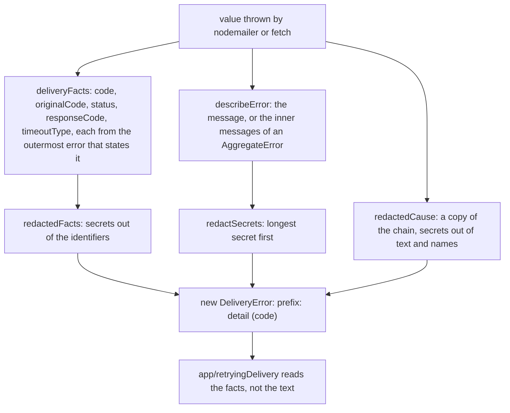

# Delivery errors

> What a failed send throws, and the failure-note text. Entries: `redactedError` (`redact.ts`),
> `DeliveryError`, `deliveryFacts` (`deliveryError.ts`), `failureTitle` and `failureOneLiner`
> (`failureNote.ts`).

## Flow

## Rules

- `redactedError` returns a new error and never holds the original: the original carries the
  unredacted text into logs and run records.
- A fact is a plain identifier (`A-Z a-z 0-9 _`, up to 64) or an integer. A numeric `code` (a
  `DOMException` has one) and a code that is free text are dropped: text may carry a secret.
- The code is added to the message when the text hides it (`fetch failed` hides `ECONNREFUSED`).
- The chain is read and copied up to `MAX_CAUSE_DEPTH` (5) levels, so a loop in `cause` ends.

## Files

| File               | Role                                                                                                                 |
| ------------------ | -------------------------------------------------------------------------------------------------------------------- |
| `deliveryError.ts` | `DeliveryError`, `DeliveryErrorFacts`, `deliveryFacts`, `statedFacts`, `causeOf`, `describeError`, `MAX_CAUSE_DEPTH` |
| `redact.ts`        | `redactSecrets`, `redactedError`                                                                                     |
| `failureNote.ts`   | `failureTitle`; `failureOneLiner` (the reason on one line, 300 characters at most)                                   |

Tests sit next to each file; no fixtures.

## Gotchas

- `app/retryingDelivery.ts` reads the facts: a new fact needs the retry rule changed too. Its tests
  and `container.secrets.test.ts` import these modules through the `// compat` files in `adapters/`.
- `config/load.ts` has its own `redactSecrets`, over the `Secrets` object. This one takes a list.
