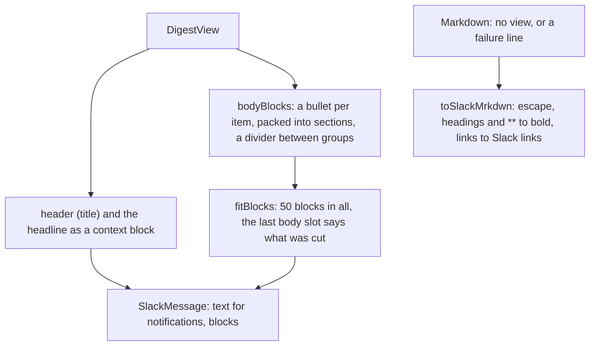

# Slack blocks

> The digest view as a Slack message, and Markdown as Slack mrkdwn. Entries:
> `toSlackBlocks(view) → SlackMessage` (`toSlackBlocks.ts`), `toSlackMrkdwn(markdown)` and
> `escapeSlack(text)` (`slackFormat.ts`). Pure: no port, no I/O.

## Flow

## Rules

- All text is escaped (`& < >`) before Slack reads it, so `<!channel>` or `<@U123>` cannot appear.
  Only http(s) URLs without a user name or password become links; `|` in a URL is encoded.
- Limits: 50 blocks, 3,000 characters a section, 150 in the header. Each field has its own budget,
  counted after escaping. The cut is made on the raw text, so `&amp;` is never split.
- No header or context block is empty: Slack rejects the whole message for one.
- Text is one line and a backtick becomes an apostrophe, so no code fence swallows later bullets.
- Pure: the same view gives the same message, and each divider is a new object.

## Files

| File               | Role                                                                    |
| ------------------ | ----------------------------------------------------------------------- |
| `toSlackBlocks.ts` | `toSlackBlocks`, `SlackBlock`, `SlackMessage`: the blocks and their fit |
| `slackFormat.ts`   | `escapeSlack`, `toSlackMrkdwn`: Markdown to mrkdwn                      |

Tests sit next to each file. `__fixtures__/` has `digest-view.json` and its golden
`digest-blocks.json`; `slack.test.ts` reads the view too.

## Gotchas

- Edit `digest-blocks.json` by hand: there is no update switch. Read the diff of a layout change.
- `SlackBlock` has four kinds (header, context, section, divider): a new kind needs the union and
  the Slack limits checked.
