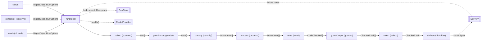
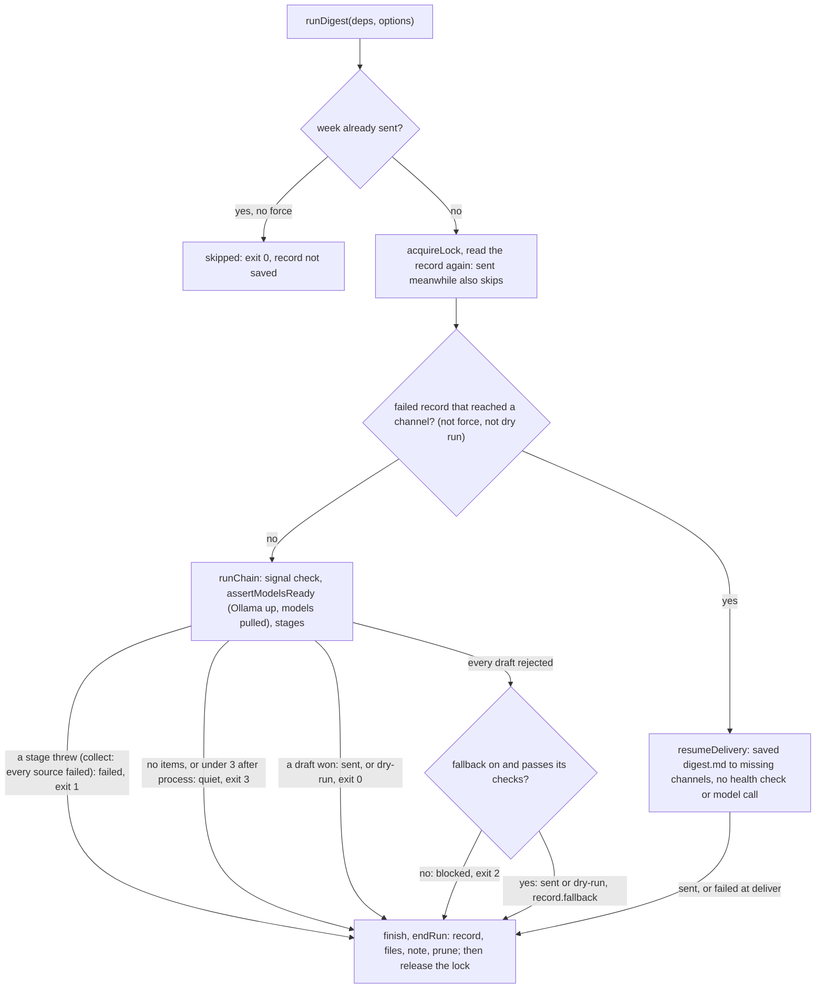

# Digest run

> Runs one weekly digest end to end and decides how the week ends: sent, dry-run, skipped, quiet,
> blocked or failed. Entry: `runDigest(deps, options) → RunResult` (`runDigest.ts`). Ports:
> `RunStore`, `Delivery`, and `ModelProvider` for the health check only.

## Context

## Flow

- Quiet after `collect` (sources answered, no items) alerts every channel; after `process` (under
  `DIGEST_MIN_ITEMS`, 3) it sends no note. All sources failing is `failed`. `runDigest` throws, not
  returns, for a bad week id, a window under 1 day or not whole, a held lock, `RecordNotSavedError`.
- A stage function in `stages/` takes the name of its stage, except `process` (`processItems`) and
  `select` (`selectWinner`). Files: items.json (collect), scores.json (classify), drafts.json (write,
  fallback), digest.md (select). The judge runs only with 2+ passing drafts and a profile judge.
  `classify` passes `models.rescoreWithWriter` (default off) and `thresholds.minRelevance`.

## Rules

- The abort signal is checked at chain start, before each stage and before a resume's delivery. It
  also enters the collect, classify, write, select and guard stages and the fallback: the fetchers,
  the guards and every model call stop within one call, and no new call or writer starts. Only
  `deliver` ignores it: a send that has started finishes. The failure starts
  `Run aborted before|during the <step> step` (`isUnretriable`), whatever it threw.
- A run never replaces a record that got further (`keepReason`, against the store as the run ends),
  else a sent week goes out twice. Meanwhile (`holdArtifacts`) its files wait in `ChainState.held`,
  written only if its record is saved. A run that lost its lock: see `deliver` in `stages/`.
- `notifyFailure` false holds a `failed` run's note for a retrying caller (the scheduler);
  `sendHeldNote` sends it later. Quiet, blocked, `Run aborted`, `--force` and "record not saved"
  notes go anyway. A dry run sends none. Notes, records and errors never hold model or feed text.
- Fallback floor: with no passing draft, `buildFallback` builds a digest from the items' own text,
  no model call. It must pass the link and format checks, or the week stays `blocked`; output
  guards only advise. No config switch (`noFallback` is for tests and the eval replay).

## Files

| File / folder   | Role                                                                                       |
| --------------- | ------------------------------------------------------------------------------------------ |
| `runDigest.ts`  | `runDigest`, `runChain`, lock handling                                                     |
| `types.ts`      | `DigestDeps`, `RunOptions`, `RunResult`                                                    |
| `fallback.ts`   | `buildFallback`: the template digest from `write/fallbackDigest`, plus its guard verdict   |
| `workflow.ts`   | `runWorkflow`: a plain loop over the stages; a step's error propagates unchanged           |
| `chain/`        | `RunContext`, `ChainState`, the stage wrapper, failure carriers: see `chain/CLAUDE.md`     |
| `stages/`       | One file per stage and `chainSteps`: see `stages/CLAUDE.md`                                |
| `health/`       | `assertModelsReady`: Ollama up, models pulled: see `health/CLAUDE.md`                      |
| `record/`       | `finish`, `skipped`, `resumed`, `buildRecord`: see `record/CLAUDE.md`                      |
| `ending/`       | `endRun` and its parts: record, files, notes, shipping: see `ending/CLAUDE.md`             |
| `resume/`       | `loadPartDelivery`, `resumeDelivery`: finish a part-delivered week: see `resume/CLAUDE.md` |
| `__fixtures__/` | Test kits: `runKit.ts` (whole runs), `stageKit.ts` (a context and chain state)             |

## Gotchas

- Renames break: `KEPT_SENT_REASON` and `KEPT_PARTLY_REASON` (`RunResult.kept`, shown by the run
  command); `--force` and `Run aborted` in a message, read by `needsForce` and `isUnretriable` and
  by `scheduler/retry/attemptRun.ts` with `RecordNotSavedError`; `DraftsFileSchema` and `toJson` (`cli` show,
  preview, fetch). `DigestDeps` is built in `app/container.ts` and `test/integration/harness/world.ts`.
- `RunResult.markdown` is set only when this run wrote digest.md; `message` when a draft won here.
- Model call order is pinned (`runDigest.failures.test.ts`). The writer retry and checks live in `write/`.
