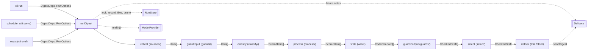
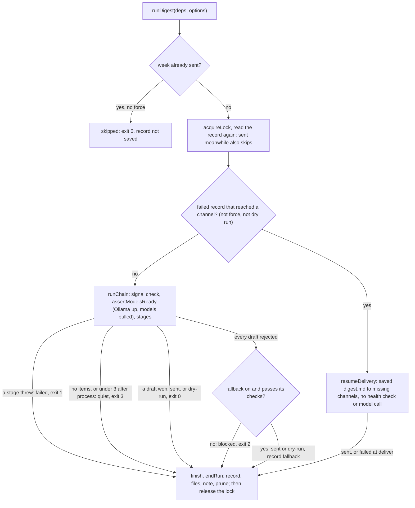

# Digest run

> Runs one weekly digest end to end and decides how the week ends: sent, dry-run, skipped, quiet,
> blocked or failed. Entry: `runDigest(deps, options) → RunResult` (`runDigest.ts`). Ports:
> `RunStore`, `Delivery`, and `ModelProvider` for the health check only.

## Context

## Flow

- Quiet after `collect` (no items) alerts every channel and names the failed sources; after
  `process` (under `DIGEST_MIN_ITEMS`, 3) it sends no note. `runDigest` throws, not returns, for a
  bad week id, a window under 1 day or not whole, a held lock and `RecordNotSavedError`.
- Stage functions: `process` runs `selectItems`, `guardOutput` `checkDrafts`, `select`
  `pickWinner` (judge only with 2+ passing drafts and a profile judge). Files per stage: items.json
  (collect), scores.json (classify), drafts.json (write, fallback), digest.md (select).
- A failing stage throws `StepFailure` (`PartialFailure` after partial work) with the state so far.

## Rules

- The abort signal is checked at chain start, before each stage and before a resume's delivery,
  never inside a stage. The failure text starts `Run aborted` (`isUnretriable` reads it).
- `keepReason`: a run never replaces a record that got further (sent, or reached a channel), else
  a sent week goes out twice. Meanwhile (`holdArtifacts`) this run's files wait in
  `ChainState.held` and are written only if its record is saved; a kept run still sends its note.
- Resume refuses (fails at `deliver`, message has `--force`) when digest.md is gone or its links
  differ from `previous.sentUrls`. Its record changes only status, times, `deliveredTo`, error.
- `notifyFailure` false holds a `failed` run's note for a retrying caller (the scheduler);
  `sendHeldNote` sends it later. Sent anyway: quiet and blocked notes, `Run aborted` and `--force`
  failures, "record not saved". A dry run sends none.
- Notes, records and errors name writers and check ids, never model or feed text.
- Fallback floor: with no passing draft, `buildFallback` builds a digest from the items' own text,
  no model call. It must pass the link and format checks, or the week stays `blocked`; output
  guards only advise. No config switch (`noFallback` is for tests and the eval replay).
- `shipDigest` tries every channel and never throws; once any took the digest, its URLs count as
  sent for dedupe. `review.md`, `error.json`, held files and pruning are best effort.

## Files

| File           | Role                                                                                     |
| -------------- | ---------------------------------------------------------------------------------------- |
| `runDigest.ts` | `runDigest`, `DigestDeps`, `RunOptions`, `RunResult`, one function per stage             |
| `runEnding.ts` | `endRun`, `keepReason`, `shipDigest`, `digestMessage`, `abortedError`, note helpers      |
| `runResume.ts` | `loadPartDelivery`, `resumeDelivery`: finish a part-delivered week                       |
| `fallback.ts`  | `buildFallback`: the template digest from `write/fallbackDigest`, plus its guard verdict |
| `workflow.ts`  | `runWorkflow`: a plain loop over the stages; a step's error propagates unchanged         |

Tests sit next to each file and use `test/fakes`; no fixtures.

## Gotchas

- `runDigest.ts` is 769 lines and `runEnding.ts` 408, both over the 300 cap. Split before adding.
- Renames break: `KEPT_SENT_REASON` and `KEPT_PARTLY_REASON` (`RunResult.kept`, shown by the run
  command); `--force` and `Run aborted` in a message, read by `needsForce` and `isUnretriable` and
  by `scheduler.ts` with `RecordNotSavedError`; `DraftsFileSchema` and `toJson` (`cli` show,
  preview, fetch). `DigestDeps` is built in `app/container.ts` and `test/integration/harness.ts`.
- `RunResult.markdown` is set only when this run wrote digest.md; `message` when a draft won here.
- Model call order is pinned (`runDigest.test.ts`). The writer retry and checks live in `write/`.
