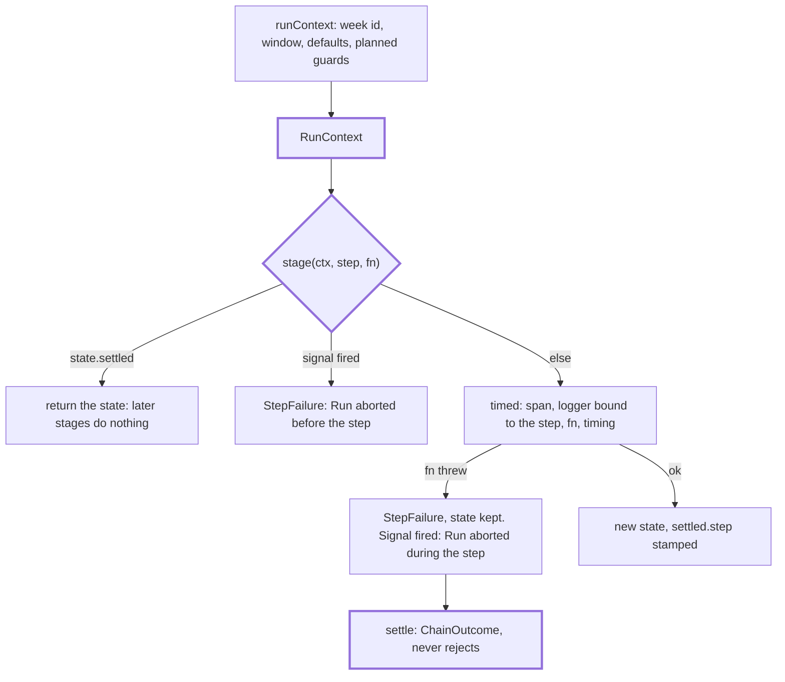

# Chain

> What every stage runs on: the run's fixed inputs (`RunContext`), the state that passes from stage
> to stage (`ChainState`), the wrapper that times a stage, and the carriers that keep the state when
> one fails. Entries: `runContext`, `stage(ctx, step, fn)`, `settle(ctx, run)`. It knows no stage.

## Flow

## Rules

- A stage returns a new `ChainState`; it never changes the one it got. `held` carries the files a
  run must not write yet (`RunContext.holdArtifacts`). `RunContext.previousRecord` is the week's
  record at the lock: `runDigest` sets it after the first read, `deliver` compares the store with it.
  `lastDelivered` (an earlier week's, read only without `--since`) widens `collect` for a late run.
- `settled` ends the run early (`quiet`, `blocked`); later stages skip it, so the chain ends
  normally and `finish` builds the record. `timed` stamps `settled.step`.
- `StepFailure.state` is the state the step started from plus the failed step's timing. A stage that
  fails after part of its work throws `PartialFailure` with that work (`write`, `deliver`).
- The abort check runs before a stage and skips a settled run. A stage that throws once the signal
  fired fails as `Run aborted during the <step> step` (`abortedDuring`), whatever it threw. Under the
  lock the signal also fires on `RunLock.lost` (`holdingLock`); `lockLost` tells the two apart.

## Files

| File            | Role                                                                 |
| --------------- | -------------------------------------------------------------------- |
| `runContext.ts` | `RunContext`, `runContext`, `holdingLock` (the lock's `lost` joins)  |
| `state.ts`      | `ChainState`, `Settled`, `DraftsFile`, `ChainOutcome`, `EMPTY_STATE` |
| `failures.ts`   | `StepFailure`, `PartialFailure`                                      |
| `stage.ts`      | `stage`, `StageFn`; the private `timed`                              |
| `settle.ts`     | `settle`: run the chain, return the outcome                          |

## Gotchas

- A new `ChainState` field also goes into `EMPTY_STATE` and, if shown, `record/buildRecord.ts`.
- The log texts `Step finished`, `Step failed`, `Run aborted`, `Run failed outside a step` are pinned.
