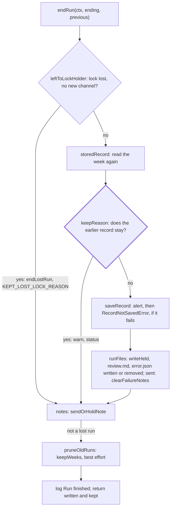

# Ending

> Closes a run: saves the record, writes the files the run held, reports the failure, sends the
> note and prunes old weeks. Entry: `endRun(ctx, ending, previous) → Ended` (`endRun.ts`). It knows
> no stage: `chain/`, `record/` and `resume/` call it. Ports: `RunStore`, `Delivery`.

## Flow

## Rules

- `keepReason`: a sent week is replaced only by a sent run; a part-delivered week only by a run that
  reached a channel. Else a sent week looks unsent and goes out twice. When the earlier record stays,
  this run's held files, `review.md` and `error.json` go with its record; the note still goes.
- `previous` is what the run read at its start. A run that lost its lock can find a newer record in
  the store (`storedRecord`, read again before saving): one that reached a channel the run did not
  start with stays too (`KEPT_OTHER_RUN_REASON`, `deliveredMeanwhile`). A read that fails keeps `previous`.
  A run that knows it lost its lock (`lockLost`) saves no record or file and prunes nothing, unless it
  reached a new channel: else the run that took over would send the week again.
- `saveRecord` is the only step that throws: it sends a note saying the record was not saved, then
  throws `RecordNotSavedError`, so a caller holding another note does not send it as well.
- Every other write is best effort: it logs and goes on. Nothing here reads model or feed text.
  error.json sits only beside a failed record; a `sent` record also clears every channel's note.
- `saveProgress` saves the record of a delivery under way (`deliver`, a resume) after each channel,
  under the same `keepReason`; its `DELIVERY_CUT_OFF` error stays only if the run died.
- `Ended.written` names the held files that reached the store; `finish` needs it for digest.md.

## Files

| File / folder     | Role                                                                                |
| ----------------- | ----------------------------------------------------------------------------------- |
| `endRun.ts`       | `endRun`, `pruneOldRuns`                                                            |
| `types.ts`        | `EndingContext`, `Ending`, `Ended`, `Failure`, `HeldArtifact`                       |
| `saveRecord.ts`   | `saveRecord`, `RecordNotSavedError`                                                 |
| `saveProgress.ts` | `saveProgress`, `DELIVERY_CUT_OFF`: the record after each channel                   |
| `keepReason.ts`   | `keepReason`, `leftToLockHolder`, `reachedAChannel`, `deliveredMeanwhile`, `KEPT_*` |
| `runFiles/`       | `toJson`, the file schemas, held files, `review.md`, `error.json`                   |
| `notes/`          | Failure notes, held notes, `abortedError`, `supersededError`, `isUnretriable`       |
| `shipping/`       | `shipDigest`, `stopBeforeSending`, `digestMessage`, `winnerMessage`                 |

## Gotchas

- Outside `src/digest`, `cli`, `scheduler` and `test/integration` import from the defining files:
  `KEPT_SENT_REASON` (`keepReason.ts`), `RecordNotSavedError` (`saveRecord.ts`), `isUnretriable` and
  `needsForce` (`notes/unretriable.ts`), `sendHeldNote` (`notes/failureNotes.ts`), `toJson` and
  `DraftsFileSchema` (`runFiles/runFiles.ts`). A rename breaks them.
