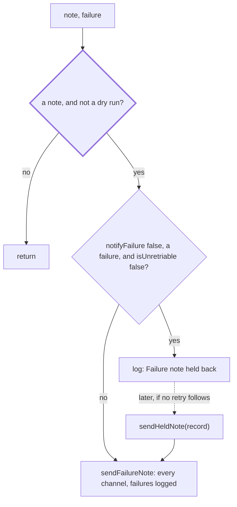

# Notes

> The failure note of a run, and the texts the scheduler reads to decide whether a failure can be
> retried. Entries: `sendOrHoldNote(ctx, note, failure)`, `sendHeldNote(...)`, `failureNote`,
> `isUnretriable`. Port: `Delivery.sendFailure`.

## Flow

## Rules

- A held note is the caller's to send: `sendHeldNote` rebuilds the very note `endRun` would have sent,
  from the record. It sends nothing for a dry-run record.
- Sent whatever `notifyFailure` says: a run told to stop (`Run aborted`, also `supersededError`: another
  run delivered the week), a failure only `--force` clears, a run that is not a failure (blocked,
  quiet), and the note that the record was not saved.
- `isUnretriable` goes by the recorded error text, never by the run's signal, so the scheduler reading
  the record decides as the run did. A message that only mentions "aborted" does not match.
- A channel that cannot take the note is logged; the others still get it, and the run outcome stands.

## Files

| File              | Role                                                                                         |
| ----------------- | -------------------------------------------------------------------------------------------- |
| `failureNotes.ts` | `failureNote`, `sendOrHoldNote`, `sendFailureNote`, `sendHeldNote`                           |
| `unretriable.ts`  | `abortedError`, `abortedDuring`, `supersededError`, `isUnretriable`, `needsForce`: the texts |

Tests sit next to each file; the `notifyFailure` cases through the whole ending are in
`../endRun.notify.test.ts`.

## Gotchas

- The `Run aborted` prefix and the `--force` text are a contract with `resume/resumeDelivery.ts`,
  `scheduler/retry`: change them together.
- The log text `Failure note held back: notifyFailure is off for this run` is asserted in tests.
