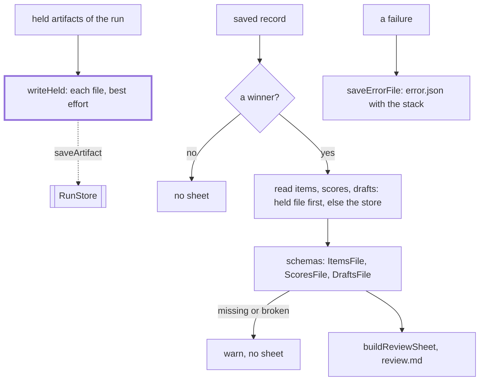

# Run files

> The files a run leaves next to its record in the store: how they are written, read back and
> checked. Entries: `toJson`, `writeHeld`, `writeReviewSheet`, `saveErrorFile`, `recordError`,
> `DraftsFileSchema`. Port: `RunStore` (`saveArtifact`, `readArtifact`).

## Flow

## Rules

- Every write here is best effort: a file that cannot be written is logged and left out. run.json
  already holds the error; error.json only adds the stack.
- `review.md` is built without a model from the run's own files, held ones first (the last held file
  of a name wins), so a dry run gets one too.
- `DraftsFileSchema` keeps only `drafts`: the rest of drafts.json (failures, rejections) is for people.
  `resume/` and `cli show`, `preview` read it to rebuild a digest.
- Every run file is pretty JSON (`toJson`). `recordError` is what run.json holds: message and step.

## Files

| File               | Role                                                                |
| ------------------ | ------------------------------------------------------------------- |
| `runFiles.ts`      | `toJson`, `ItemsFileSchema`, `ScoresFileSchema`, `DraftsFileSchema` |
| `heldArtifacts.ts` | `writeHeld`: write the files a run held, name the ones written      |
| `reviewSheet.ts`   | `writeReviewSheet`: review.md from items, scores and the winner     |
| `errorFile.ts`     | `saveErrorFile`, `recordError`                                      |

## Gotchas

- `toJson` and `DraftsFileSchema` (`runFiles.ts`) are imported by `cli fetch`, `preview` and `show`;
  a change to either changes those commands.
